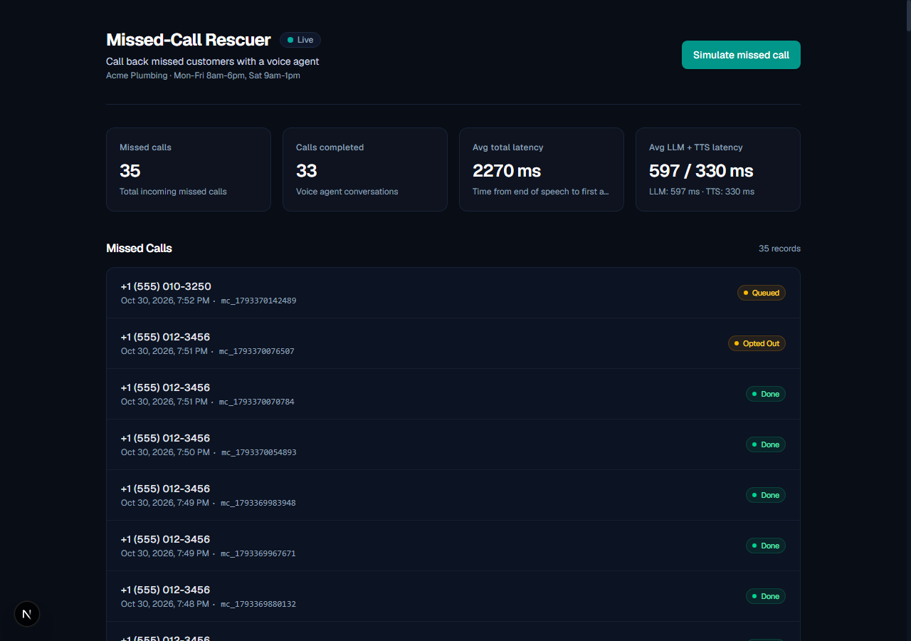
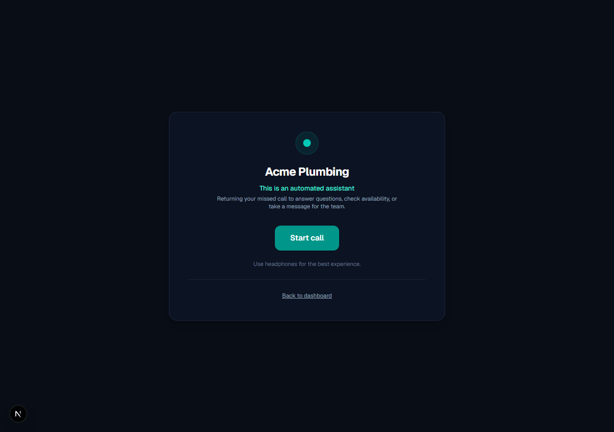

# Missed-Call Rescuer

Small shops lose customers to missed calls. Missed-Call Rescuer calls them back with a voice agent, finds out what they wanted, and gives the owner a structured summary.

## Demo

- **Demo Video**: [Watch the 1-minute walkthrough](TODO_ADD_VIDEO_URL) *(paste your YouTube / Loom link here)*

### Dashboard Interface


### Customer Call Interface


## What It Does

1. A missed call is simulated or recorded for the business.
2. The customer receives a callback link (`/call/{id}`).
3. The voice assistant greets the caller and explicitly discloses that it is an automated assistant.
4. The customer speaks naturally with the assistant, with real-time barge-in support to interrupt at any point.
5. When the call ends, a structured summary (reason, urgency, preferred callback time, contact details, suggested action, sentiment) appears live on the owner dashboard via Server-Sent Events.

## Try It

1. Open the owner dashboard at `http://localhost:3010`.
2. Click "Simulate missed call" to generate a callback task.
3. Open the generated callback link (`/call/{id}`) in Chrome or Edge.
4. Put on headphones and click "Start call" (allow microphone access).
5. Listen to the automated greeting, then speak naturally (e.g., "My pipe is leaking under the sink").
6. Test barge-in: speak while the agent is talking to verify instant audio cutoff.
7. Test opt-out: say "Stop calling me" to verify polite call termination, then return to `http://localhost:3010` to view the live structured summary and latency metrics.

## How It Uses AssemblyAI

Missed-Call Rescuer uses AssemblyAI Streaming TTS (`assemblyai-tts-1`) over a persistent WebSocket connection:
- Protocol: The server sends JSON `Generate` and `Flush` text commands over WebSocket. AssemblyAI returns JSON `Audio` frames containing base64-encoded audio. The server decodes these to 24 kHz 16-bit linear PCM binary buffers and forwards them directly to the browser over its WebSocket connection. The client emits `Cancel` on barge-in to immediately discard pending audio, and sends periodic `KeepAlive` frames.
- Early Chunking: Instead of waiting for full sentences, the agent flushes the first chunk to AssemblyAI TTS as soon as a clause boundary (`,`, `;`, `:`, `—`, `--`) or 6 words are generated, streaming subsequent text by sentence.
- Audio Delivery: The browser receives binary PCM chunks over WebSocket and schedules them sequentially with zero gap using the Web Audio API.
- Customer Speech Input: Speech recognition currently uses the browser Web Speech API (`webkitSpeechRecognition` in Chrome or Edge).

## Latency

Measured averages from automated 5-turn test runs (`scripts/verify-pipeline.ts`):

| Metric | Measured Average | Range | Description |
|---|---|---|---|
| LLM First Token (`llmFirstTokenMs`) | 322 ms | 288–348 ms | Time from customer turn end to first streamed LLM token |
| TTS First Audio (`ttsFirstAudioMs`) | 364 ms | 352–382 ms | Time from `Generate` command to first audio frame from AssemblyAI |
| Total Time to First Audio (`totalMs`) | 708 ms | 668–733 ms | Time from end of recognized speech to first audio byte |

Notes on measurement:
- Across multiple pipeline test runs, total latency consistently ranges between about 0.7 to 0.8 s.
- The primary metric is strictly defined as the time from the end of recognized speech to the first audio byte played back.
- Browser speech recognition (Chrome/Edge Web Speech API) enforces an internal silence window of approximately 0.8 to 1.2 seconds before marking speech final, which precedes the measured timer.
- Latency was measured from India over a transcontinental WebSocket connection to the AssemblyAI US endpoint, paired with Groq (`qwen/qwen3.8-27b`). Real-world latency depends on user network location and the chosen LLM provider.

## Architecture

```
[ Customer Call Page ] <====== WebSocket ======> [ Express API Server ]
  (Web Speech API)                                  |   |
  (Web Audio PCM)                                   |   +---> AssemblyAI TTS (WebSocket)
                                                    |   +---> LLM API (Groq)
                                                    |   +---> SQLite (better-sqlite3)
[ Owner Dashboard ]    <--- SSE & REST API ---------+
```

| File | Purpose |
|---|---|
| `server/index.ts` | Express server, HTTP routes, SSE stream, and WebSocket upgrade handler |
| `server/session.ts` | Call session state machine, early chunking buffer, turn tracking, and barge-in |
| `server/tts.ts` | AssemblyAI Streaming TTS WebSocket client (`Generate`, `Flush`, `Cancel`, `KeepAlive`) |
| `server/llm.ts` | Streaming LLM completions, connection pooling, system prompts, and structured JSON summarization |
| `server/db.ts` | SQLite database initialization, schemas, and queries |
| `server/events.ts` | Server-Sent Events broker for real-time dashboard events |
| `src/app/page.tsx` | Next.js owner dashboard displaying missed calls, live summaries, and latency averages |
| `src/app/call/[token]/page.tsx` | Customer call UI running Web Speech recognition, Web Audio playback, and metrics |

Call state machine:
`GREETING` -> `SPEAKING` <-> `LISTENING` (via `THINKING`) -> `ENDING` -> `SUMMARIZING` -> `DONE`

## Safety and Behavior

- Disclosure: The agent explicitly discloses in its opening greeting that it is an automated assistant.
- Opt-Out and Wrong Numbers: Detects opt-out phrases ("stop calling", "remove me", "don't call") which mark the missed call record as `opted_out`. Detects wrong-number phrases ("wrong number", "not the right person") which end the call with reason `wrong_number` and mark the missed call `done`.
- Strict Bounds: The system prompt instructs the agent to answer only from the provided business configuration (hours, services, FAQs).
- No Promised Commitments: The agent never invents prices or promises appointment bookings, explicitly noting that the business owner will confirm.
- Conciseness: Responses are constrained to a single sentence under 20 words for fast conversational pacing.

## Setup

### Prerequisites
- Node.js 20 or higher
- Google Chrome or Microsoft Edge (required for Web Speech API support)
- Headphones recommended (prevents microphone feedback from speaker audio triggering accidental barge-in)

### Installation
1. Clone the repository and install dependencies:
   ```bash
   git clone https://github.com/shobhitsahani/Missed-Call-Rescuer.git
   cd Missed-Call-Rescuer
   npm install
   ```

2. Configure environment variables:
   ```bash
   cp .env.example .env
   ```

   Required environment variables in `.env`:
   - `ASSEMBLYAI_API_KEY`: AssemblyAI API key for TTS (dummy: `your_assemblyai_api_key_here`)
   - `ASSEMBLYAI_VOICE_ID`: Voice model ID (default: `aai-jane`)
   - `OPENAI_API_KEY`: API key for LLM provider (dummy: `gsk_example_key_or_openai_key`)
   - `OPENAI_BASE_URL`: Base URL for OpenAI-compatible endpoint (default: `https://api.groq.com/openai/v1`)
   - `OPENAI_MODEL`: LLM model identifier (default: `qwen/qwen3.8-27b`)
   - `NEXT_PUBLIC_API_BASE`: API base URL for frontend (default: `http://localhost:4000`)
   - `PORT`: Express server port (default: `4000`)
   - `FIRST_CHUNK_MIN_WORDS`: Word threshold before flushing chunk 1 to TTS (default: `6`)

3. Start development servers:
   ```bash
   npm run dev
   ```
   Open the owner dashboard at `http://localhost:3010`.

### Benchmark Scripts
- Benchmark LLM Time-to-First-Token (5 runs):
  ```bash
  npx tsx scripts/llm-latency.ts
  ```
- Run automated end-to-end pipeline verification (5 turns, barge-in, opt-out):
  ```bash
  npx tsx scripts/verify-pipeline.ts
  ```

> Note: Any OpenAI-compatible endpoint works. Groq is the tested fast option using `qwen/qwen3.8-27b` (measured 311 ms average TTFT via `scripts/llm-latency.ts`). Free OpenRouter models were too slow for real-time voice (3 to 11+ second queue delays).

## Known Limitations

- Browser-only calls: Audio runs inside the browser using Web Audio and the Web Speech API; no PSTN or real telephony is connected.
- Single business: Database currently seeds a single business profile (`Acme Plumbing`).
- Speech recognition browser dependency: Web Speech API is supported primarily on Chrome and Edge and is configured for `en-US`.
- Session state: Call state is held in-memory on the active server process alongside SQLite records.
- Free-tier rate limits: Groq free tiers have low rate limits, requiring modest spacing between rapid test calls.

## What's Next

- AssemblyAI Streaming STT: Replace the browser Web Speech API with AssemblyAI's streaming STT WebSocket to enable cross-browser support and reduce silence endpointing delay.
- Telephony Integration: Connect Twilio or Telnyx SIP trunking to place real outbound phone calls.
- Multi-Tenant Support: Allow multiple businesses to register accounts and configure hours, services, and FAQs.
- Callback Scheduling: Background job queue to manage retry logic, scheduling windows, and business callback limits.

## License and Credits

- License: MIT License (see [LICENSE](LICENSE) file).
- Voice Synthesis: Powered by AssemblyAI Streaming TTS (`assemblyai-tts-1`).
