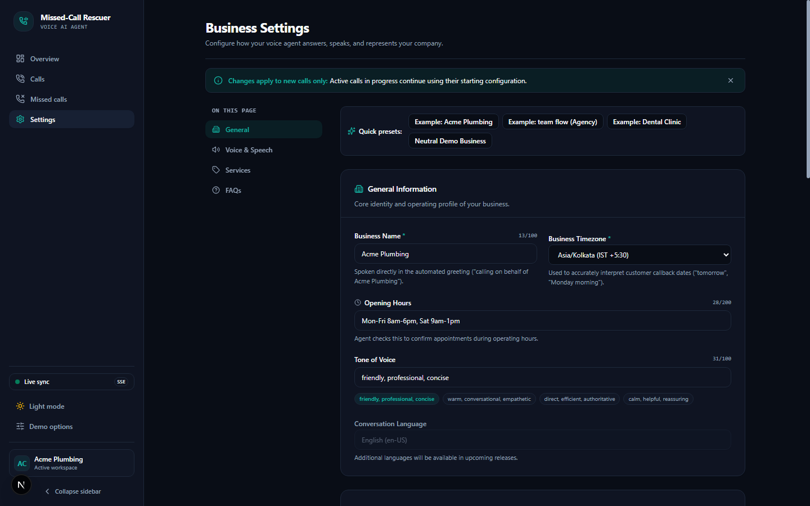
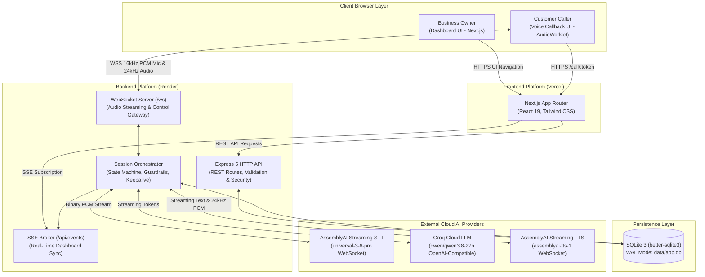
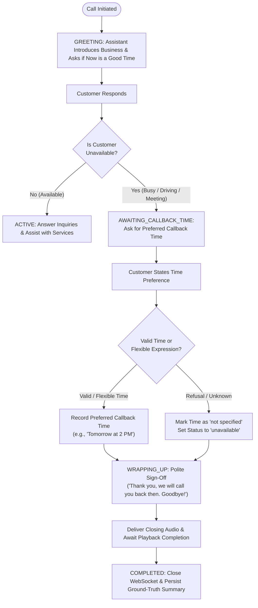
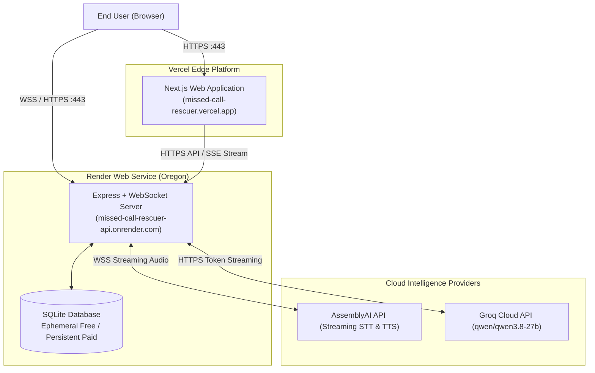

# Missed-Call Rescuer

**Missed-Call Rescuer** is an intelligent AI-powered voice callback assistant that converts unhandled missed calls into immediate, browser-based voice callback sessions. Operating on behalf of small trade and service businesses, the assistant calls the customer back in their browser, ascertains urgency, answers inquiries strictly within configured business bounds (hours, services, FAQs), captures callback preferences when customers are unavailable, and generates structured call summaries for the business owner dashboard.

[](LICENSE)
[](https://nextjs.org/)
[](https://react.dev/)
[](https://nodejs.org/)
[](https://expressjs.com/)
[](https://www.typescriptlang.org/)
[](https://tailwindcss.com/)

**Live Application**: [https://missed-call-rescuer.vercel.app](https://missed-call-rescuer.vercel.app)  
**Source Code Repository**: [https://github.com/shobhitsahani/Missed-Call-Rescuer](https://github.com/shobhitsahani/Missed-Call-Rescuer)  
**Backend API / Health Check**: [https://missed-call-rescuer-api.onrender.com/api/health](https://missed-call-rescuer-api.onrender.com/api/health)  
**Architecture & Design Guide**: [docs/ARCHITECTURE.md](docs/ARCHITECTURE.md)

---

## Interface Preview

### Business Owner Dashboard
Real-time call tracking, instant metric cards, turn-by-turn drawer inspection, and full transcript downloads.


### Customer Voice Callback Interface
Low-latency full-duplex conversational voice interface with live interim transcription and visual agent states.


### Business Settings & Neural Voice Preview
Custom business operating hours, service catalogs, tone settings, and live audio preview for 12 AssemblyAI neural voices.



---

## Product Overview

### The Problem
When prospective customers reach out to service businesses (plumbers, electricians, HVAC technicians, dental clinics, auto repair shops) and encounter voicemail or an unanswered phone, **over 80% do not leave a message**—they immediately call a competitor. For a small business, a single missed call can represent thousands of dollars in lost revenue.

### The Solution
**Missed-Call Rescuer** bridges the gap between a missed inbound inquiry and owner follow-up:
1. Logs the missed call event and issues a secure, unguessable callback session link.
2. The caller opens the link in their web browser and is greeted by a responsive voice assistant speaking on behalf of the business.
3. The assistant identifies customer urgency, answers questions strictly from the business profile (hours, services, FAQs), and captures callback details.
4. If the customer indicates they are unavailable, the assistant asks for their preferred callback time, records it, and concludes without asking unrelated questions.
5. On call completion, the assistant generates a structured JSON summary (intent, urgency, sentiment, callback details, suggested actions).
6. The owner dashboard updates instantly via Server-Sent Events (SSE).

### System Scope & Operational Reality

| Capability | Current Status | Details |
|---|---|---|
| **Voice Conversation** | Implemented (Browser) | Full-duplex voice streaming over WebSockets via Web Audio API & AudioWorklet. |
| **PSTN / Carrier Telephony** | Out of Scope / Unsupported | No physical carrier telephony, SIP trunking, or PSTN dialers (e.g. Twilio/Telnyx). Sessions execute in modern desktop/mobile web browsers. |
| **Missed-Call Ingestion** | Implemented (Simulated/API) | Created via dashboard simulation button or HTTP API (`POST /api/missed-calls/simulate`). |
| **Outbound Telephony Dialer** | Scaffolded | `callback_jobs` rows are tracked in SQLite; automated telephony dialer background workers are not currently implemented. |
| **Multi-Industry Support** | Implemented | Shared voice agent adapts dynamically across different industries through the Business Settings configuration interface. |
| **Tenancy Model** | Single Business Demo | Configurable business profile (`Acme Plumbing` default) with industry presets. Multi-tenant customer accounts are not currently implemented. |

---

## How It Works

```
 ┌────────────────┐       ┌────────────────┐       ┌────────────────┐       ┌────────────────┐
 │ 1. Simulate    │       │ 2. Launch      │       │ 3. Voice       │       │ 4. Structured  │
 │    Missed Call ├──────>│    Callback    ├──────>│    Dialogue    ├──────>│    Summary     │
 │   (Dashboard)  │       │    (/call/:tk) │       │   (WebSocket)  │       │  (Extraction)  │
 └────────────────┘       └────────────────┘       └────────────────┘       └───────┬────────┘
                                                                                    │
                                                           ┌────────────────┐       │
                                                           │ 5. Real-Time   │<──────┘
                                                           │    Dashboard   │
                                                           │   (SSE Stream) │
                                                           └────────────────┘
```

1. **Simulate Missed Call**: The business owner or evaluator clicks **"Simulate missed call"** in the dashboard header.
2. **Launch Callback**: The backend creates a missed-call record with a 128-bit unguessable token valid for 30 minutes (`/call/[token]`).
3. **Voice Dialogue**: The caller opens the link, grants microphone access, and converses with the assistant. Audio is downsampled to 16 kHz PCM in an AudioWorklet and streamed over WebSocket to AssemblyAI Streaming STT.
4. **Structured Summary**: Upon call conclusion or polite sign-off, the Groq LLM extracts a structured JSON summary distinguishing known from unknown information.
5. **Real-Time Dashboard**: The dashboard refreshes immediately via Server-Sent Events (`/api/events`) displaying completion indicators, turn playback, and latency metrics.

---

## High-Level Architecture



---

## Key Features

### AI Voice Agent
- **Real-Time Duplex Audio**: Low-latency bidirectional audio streaming using WebSockets.
- **AudioWorklet PCM Capture**: Raw microphone audio is captured and downsampled to 16 kHz mono linear PCM (`pcm_s16le`) in a dedicated browser audio thread ([public/audio-processor.js](public/audio-processor.js)).
- **Web Audio 24 kHz Playback**: Agent speech chunks received over WebSocket are decoded and scheduled gaplessly through the Web Audio API.
- **AssemblyAI Streaming STT (v3)**: High-speed speech recognition using `universal-3-6-pro` with word-level timestamps and endpointing silence thresholds.
- **Groq Fast LLM Inference**: Sub-second time-to-first-token using `qwen/qwen3.8-27b` over an OpenAI-compatible API.
- **AssemblyAI Streaming TTS (v1)**: Expressive neural voice synthesis generating 24 kHz linear PCM audio.
- **Early Clause Chunking**: Streams early sentence fragments (>= 6 words or punctuation boundaries `,`, `;`, `:`, `—`) to TTS to minimize turnaround latency.
- **Customer Interruption (Barge-In)**: Instantly halts speech synthesis, emits `{ type: 'stop_audio' }`, aborts in-flight LLM generation, and transitions to listening when the customer speaks over the agent.
- **Automatic Call Termination**: Detects closing sign-offs (`"thank you, goodbye"`), transitions to wrapping up, awaits client playback confirmation, and idempotently concludes the session.

### Business Configuration
A unified voice agent adapts dynamically across different service industries through the **Business Settings** interface:
- **Business Name**: Used in agent introduction and sign-off greetings.
- **Timezone**: IANA timezone identifier (e.g. `America/New_York`, `Asia/Kolkata`) for accurate scheduling.
- **Opening Hours**: Operating schedule consulted by the agent when customers ask about availability.
- **Tone of Voice**: Configurable assistant persona (`friendly, professional, concise`, `direct`, `empathetic`).
- **Conversation Language**: Language code (`en`, `es`, `fr`, `de`, `hi`) applied during conversation.
- **Voice Selection**: Selection of 12 AssemblyAI neural voices (`aai-jane`, `aai-brian`, `aai-emma`, etc.) with instant audio sample preview.
- **Offered Services**: Specific services the business provides. The assistant answers inquiries strictly from this list.
- **Frequently Asked Questions**: Custom Q&A pairs for business-specific policies, pricing guidelines, or licensing.
- **Quick Presets**: 1-click presets for common service businesses (Acme Plumbing, team flow Agency, Bright Smiles Dental Clinic, Generic Service).

> [!NOTE]
> **Single Shared Agent Architecture**: Rather than requiring a different AI model or custom agent codebase for every industry, the same underlying voice agent dynamically adopts the configured business profile, services, and FAQs.

### Conversation Management
- **Explicit Conversation States**: Controlled state machine transitions (`GREETING`, `ACTIVE`, `AWAITING_CALLBACK_TIME`, `WRAPPING_UP`, `COMPLETED`).
- **Customer Unavailability Detection**: Detects unavailability across conversational phrases and multiple languages (`busy`, `can't talk`, `in a meeting`, `driving`, `call back later`, `estoy ocupado`, `ne peux pas parler`, `später anrufen`, `baad me call karo`).
- **Callback-Time Capture & Validation**: Validates customer-provided callback preferences, accepting explicit or flexible time expressions (`"tomorrow at 2 PM"`, `"in two hours"`, `"anytime Friday"`) while rejecting arbitrary numbers or non-time statements.
- **Phone-Number Validation**: Normalizes spoken digits, handles `"double"` and `"triple"` expressions, stitches multi-turn number fragments, validates area codes, and respects caller refusal without looping.
- **Strict Structured Summarization**: Extracts caller intent, urgency level (`low`, `medium`, `high`), preferred callback time, contact details, suggested actions, and sentiment. Distinguishes known information from unknown information when summarization is unavailable.

### Reliability and Error Handling
- **Terminal Message Delivery**: Terminal message whitelist (`summary`, `agent_audio_end`, `error`) guarantees delivery of call summaries and closing signals before socket closure.
- **Frontend Error Preservation**: Prevents generic connection failure messages from overwriting specific backend, rate limit, or microphone errors.
- **Single-Use Token Rollback**: If an unstarted call disconnects during greeting or initialization, the backend rolls back `call_started_at = NULL` and `status = 'queued'`, allowing instant retry without burning the link.
- **Atomic Token Claiming**: Atomic compare-and-swap SQL queries ensure simultaneous connection attempts using the same token cannot create duplicate active sessions.
- **Old Session Isolation**: Protects active sessions against delayed cleanup or stale teardown handlers from previous connection attempts.
- **Application-Level WebSocket Keepalive**: 20-second ping interval prevents cloud reverse proxies (Render) from terminating idle connections.
- **Duplicate Transcript Suppression**: 1500ms deduplication window suppresses rapid duplicate STT events from cancelling in-flight LLM requests.
- **Structured Diagnostic Logging**: Emits structured JSON events across 20 distinct lifecycle checkpoints with correlation IDs and credential masking.
- **Safe TTS Text Sanitization**: Strips markdown symbols, asterisks, bullet points, headers, and code snippets from LLM outputs before synthesis.

---

## Conversation Lifecycle

The voice assistant follows an explicit state machine:

- **GREETING**: The assistant introduces itself as an automated assistant calling on behalf of the configured business and asks if now is a good time to chat.
- **ACTIVE**: The customer is available; the assistant answers inquiries strictly from the configured business profile and collects details.
- **AWAITING_CALLBACK_TIME**: The customer indicates they are unavailable; the assistant prompts for a preferred callback time.
- **WRAPPING_UP**: The assistant confirms collected information or callback preference, gives a brief polite sign-off, and initiates finalization.
- **COMPLETED**: Playback completion is confirmed, the WebSocket closes cleanly, and the structured summary is persisted to SQLite.

### Customer Unavailability Flow



> [!IMPORTANT]
> When a customer indicates they are unavailable, the agent asks for their preferred callback time, records it, and concludes the call without asking unrelated service or promotional questions.

---

## Technology Stack

| Layer | Technology | Version | Purpose |
|---|---|---|---|
| **Frontend Framework** | Next.js App Router | `16.4.3` | React Server Components, client routing, layout architecture |
| **Frontend UI Library** | React / React DOM | `19.3.0` | Declarative user interface components |
| **Styling & Design System** | Tailwind CSS / Radix UI | `^4.0` / `^1.3` | Utility styling, accessible dialogs, drawers, and tooltips |
| **Tables & Visualizations** | TanStack Table / Recharts | `^8.21` / `^3.10` | Sortable data tables and latency charts |
| **Backend Runtime** | Node.js with tsx | Node `20+` | Server runtime with native TypeScript execution |
| **HTTP Framework** | Express | `^5.3.0` | REST API routes, middleware, and static asset delivery |
| **WebSocket Engine** | ws | `^8.22.0` | Real-time bidirectional audio and event streaming |
| **Speech-to-Text** | AssemblyAI Streaming STT | `universal-3-6-pro` | Real-time speech recognition and turn detection (v3 WS) |
| **Text-to-Speech** | AssemblyAI Streaming TTS | `v1 WebSocket` | Streaming neural voice synthesis at 24 kHz |
| **LLM Provider** | Groq / OpenAI SDK | `^7.45.1` | Ultra-fast token streaming (`qwen/qwen3.8-27b`) |
| **Database** | SQLite via better-sqlite3 | `^13.0.3` | Local relational persistence with WAL journal mode |

---

## Prerequisites & Installation

### Prerequisites
- **Node.js**: Version 20.0.0 or higher.
- **npm**: Version 9.0.0 or higher.
- **Browser**: Google Chrome or Microsoft Edge recommended (AudioWorklet and Web Audio API supported; headphones recommended to eliminate microphone feedback).
- **API Keys**:
  - AssemblyAI API Key ([AssemblyAI Console](https://www.assemblyai.com/))
  - Groq API Key ([Groq Console](https://console.groq.com/)) or OpenAI API Key

### Local Setup

1. **Clone the repository**:
   ```bash
   git clone https://github.com/shobhitsahani/Missed-Call-Rescuer.git
   cd Missed-Call-Rescuer
   ```

2. **Install dependencies**:
   ```bash
   npm install --include=dev
   ```
   *(Note: `tsx` is a devDependency used to execute TypeScript server scripts).*

3. **Configure environment variables**:
   ```bash
   cp .env.example .env
   ```
   Edit `.env` and configure your API credentials:
   ```env
   ASSEMBLYAI_API_KEY=your_assemblyai_api_key_here
   OPENAI_API_KEY=gsk_your_groq_api_key_here
   OPENAI_BASE_URL=https://api.groq.com/openai/v1
   OPENAI_MODEL=qwen/qwen3.8-27b
   ALLOWED_ORIGINS=http://localhost:3010
   NEXT_PUBLIC_API_BASE=http://localhost:4000
   ```

4. **Start the development servers**:
   ```bash
   npm run dev
   ```
   This runs both services concurrently:
   - **Frontend Web Dashboard**: [http://localhost:3010](http://localhost:3010)
   - **Backend API & WebSocket Server**: [http://localhost:4000](http://localhost:4000)

5. **Verify server health**:
   ```bash
   curl http://localhost:4000/api/health
   ```
   Expected response:
   ```json
   {
     "ok": true,
     "components": {
       "database": { "status": "ok" },
       "tts": { "status": "ok", "apiKey": "configured", "voiceId": "aai-jane" },
       "stt": { "status": "ok", "apiKey": "configured", "model": "universal-3-6-pro" },
       "llm": { "status": "ok", "apiKey": "configured", "model": "qwen/qwen3.8-27b" }
     }
   }
   ```

---

## Environment Variables Reference

| Variable | Description | Required? | Configured On | Secret? | Default / Example |
|---|---|---|---|---|---|
| `NEXT_PUBLIC_API_BASE` | Public HTTPS/HTTP URL of backend API | Yes (Web) | Vercel & `.env` | No | `http://localhost:4000` |
| `PORT` | Backend HTTP & WebSocket port | No | Backend (`.env`) | No | `4000` |
| `NODE_ENV` | Application environment mode | No | Both | No | `development` / `production` |
| `ALLOWED_ORIGINS` | Permitted CORS & WebSocket origins (comma-separated) | Yes (Prod) | Backend | No | `http://localhost:3010,https://missed-call-rescuer.vercel.app` |
| `ASSEMBLYAI_API_KEY` | AssemblyAI credential for Streaming STT & TTS | Yes | Backend | **Yes** | `your_assemblyai_api_key_here` |
| `ASSEMBLYAI_VOICE_ID` | Default neural voice model identifier | No | Backend | No | `aai-jane` |
| `ASSEMBLYAI_SPEECH_MODEL` | Streaming speech-to-text recognition model | No | Backend | No | `universal-3-6-pro` |
| `STT_PROVIDER` | Speech recognition engine (`assemblyai` or `browser`) | No | Backend | No | `assemblyai` |
| `OPENAI_API_KEY` | LLM API key (Groq, OpenAI, or OpenRouter) | Yes | Backend | **Yes** | `gsk_your_groq_api_key_here` |
| `GROQ_API_KEY` | Optional Groq key (takes precedence when set) | No | Backend | **Yes** | `gsk_your_groq_api_key_here` |
| `OPENAI_BASE_URL` | Base URL for OpenAI-compatible endpoint | Yes (Groq) | Backend | No | `https://api.groq.com/openai/v1` |
| `OPENAI_MODEL` | Model identifier for conversation & summary | No | Backend | No | `qwen/qwen3.8-27b` |
| `FIRST_CHUNK_MIN_WORDS` | Minimum words before early TTS chunk dispatch | No | Backend | No | `6` |
| `DB_PATH` | Path to persistent SQLite database file | No | Backend | No | `./data/app.db` |
| `MAX_CONCURRENT_CALLS` | Cap on simultaneous active voice sessions | No | Backend | No | `2` |
| `MAX_CALLS_PER_DAY` | Daily budget limit for total voice sessions | No | Backend | No | `100` |
| `MAX_CALL_SECONDS` | Maximum allowed duration per call in seconds | No | Backend | No | `300` (5 minutes) |
| `ADMIN_TOKEN` | Bearer secret for admin endpoints in production | No (Prod) | Backend | **Yes** | `your_admin_secret_token` |

> [!WARNING]
> **Client Security Invariant**: Variables prefixed with `NEXT_PUBLIC_` are bundled into client-side browser JavaScript. Never prefix API keys, bot tokens, or database paths with `NEXT_PUBLIC_`.

---

## Testing & Quality Assurance

The repository includes an extensive automated test suite covering state machines, connection lifecycles, security controls, and speech pipelines:

```bash
# 1. Main unit & regression suite (API base, platform, transcripts, phone collection, settings, latency, state machine)
npm test

# 2. Conversation state machine & unavailability flow tests
npm run test:state-machine

# 3. Connection lifecycle & recovery regression suite (18 scenarios: WS connect, token rollback, idempotency, etc.)
npm run test:lifecycle

# 4. Auto-termination & playback-completion handshake regression suite (10 scenarios)
npm run test:termination

# 5. Security & hardening regression suite (CORS, tokens, single-use, budgets, rate limits)
npm run test:security

# 6. Reconnection & token lifecycle test
npm run test:reconnect

# 7. Voice preview cancellation regression test
npm run test:preview

# 8. Secret exposure & credential leak scan
npm run check:secrets

# 9. TypeScript typecheck
npm run typecheck

# 10. Linting
npm run lint

# 11. Production build validation
npm run build
```

### Test Coverage Summary

| Test Command | Scope | Requires Live Server? | External Cloud Keys? |
|---|---|---|---|
| `npm run typecheck` | Full repository TypeScript compilation | No | No |
| `npm run lint` | ESLint rules across frontend and backend | No | No |
| `npm test` | Core unit suites + settings validation + state machine (25 tests) | Yes (:4000) for settings test | No |
| `npm run test:state-machine` | Unavailability detection, callback validation, multi-industry config | No | No |
| `npm run test:lifecycle` | 18 lifecycle scenarios (token rollback, CAS claim, rapid duplicate deduplication, error preservation) | Self-spawning (:4130) | No |
| `npm run test:termination` | 10 auto-termination regression tests (goodbye classification, finalization state, playback handshake) | Self-spawning (:4125) | No |
| `npm run test:security` | 11 security hardening tests (CORS, tokens, budgets, single-use, rate limits) | Self-spawning (:4098) | No |
| `npm run test:reconnect` | Token reconnect grace period and single-use guarantee | Self-spawning (:4098) | No |
| `npm run test:preview` | Client abort and socket release on voice preview | Self-spawning (:4098) | No |
| `npm run test:e2e` | Live voice workflow end-to-end evaluation | Self-spawning | **Yes** (`ASSEMBLYAI_API_KEY`, `OPENAI_API_KEY`) |

---

## Deployment Architecture

The production deployment is decoupled into a static/SSR frontend hosted on Vercel and a persistent stateful API and WebSocket worker hosted on Render.



### 1. Frontend on Vercel
- **Root Directory**: `.` (Repository root)
- **Framework Preset**: Next.js
- **Build Command**: `next build`
- **Output Directory**: `.next`
- **Required Environment Variables**:
  - `NEXT_PUBLIC_API_BASE`: `https://missed-call-rescuer-api.onrender.com`

### 2. Backend on Render (`render.yaml`)
- **Service Type**: Web Service (Node.js)
- **Plan**: Free (or Starter with Persistent Disk)
- **Build Command**: `npm install --include=dev`
- **Start Command**: `npx tsx server/index.ts`
- **Health Check Path**: `/api/health`
- **Filesystem Persistence Note**:
  - Render free tier instances operate on an **ephemeral disk**. SQLite data survives in-place process restarts but is cleared upon instance redeployment or server sleep cycles.
  - To retain permanent historical records, attach a Render persistent disk mounted at `/var/data` and configure `DB_PATH=/var/data/app.db`.
- **Free-Tier Cold Starts**: Render free instances spin down after 15 minutes of inactivity. An initial wake-up request may take 30–60 seconds. The frontend features built-in retry handling and status indicators to guide evaluators during cold starts.

---

## Security & Privacy Considerations

- **Opaque 128-Bit Tokens**: Callback URLs utilize unguessable 32-character hexadecimal tokens (`crypto.randomBytes(16)`). Guessable database IDs (`mc_...`) are rejected by HTTP endpoints and WebSocket joins.
- **Atomic Token Claiming & Single-Use**: Tokens are atomically claimed when a call starts via compare-and-swap SQL queries. Concluded calls cannot be joined a second time.
- **30-Minute Expiration**: Tokens expire automatically 30 minutes after creation with an HTTP 410 Gone status.
- **Strict Origin Checking**: CORS policies and WebSocket connection upgrades enforce `ALLOWED_ORIGINS`. Unauthorized cross-origin WebSocket connections are rejected with HTTP 403 Forbidden.
- **Data Minimization & Phone Masking**: Public Server-Sent Events (SSE) and `/api/missed-calls` omit callback tokens from broadcast payloads and mask customer phone numbers (`+1 ******1234`).
- **Resource Budgeting**: Concurrency caps (`MAX_CONCURRENT_CALLS=2`), daily limits (`MAX_CALLS_PER_DAY=100`), and duration timers (`MAX_CALL_SECONDS=300`) protect upstream AI provider allowances.
- **Admin Gating**: Destructive endpoints (`/api/admin/clear-test-data`) require `ADMIN_TOKEN` via the `x-admin-token` header when deployed in production.

---

## Known Limitations

- **Browser-Only Voice Transport**: Calls execute exclusively within the web browser via WebSockets and Web Audio. There is no physical carrier integration (PSTN/SIP) to dial telephone handsets.
- **Browser Autoplay & Permissions**: Modern browsers require an explicit user gesture ("Start call" click) before opening microphone inputs or resuming Web Audio contexts.
- **Acoustic Feedback**: Without physical acoustic echo cancellation on some hardware, speaker audio can bleed into the microphone. Using headphones is recommended during testing.
- **Callback Job Queue**: Rows are created and logged in `callback_jobs`, but an automated background dialing daemon is not currently active.
- **In-Memory Session Orchestration**: Active call state (buffers, timers, provider clients) resides in server process memory. Multi-instance scaling requires sticky sessions or an external Redis state store.
- **Ephemeral Storage on Free Tier**: Render free tier disk is ephemeral; historical calls reset on redeployment unless a persistent disk is attached.
- **Provider Cold-Starts & Rate Limits**: Upstream cloud AI providers enforce concurrency limits; free tier Render instances sleep after 15 minutes of inactivity.

---

## Documentation & References

- **System Architecture & High-Level Design**: [docs/ARCHITECTURE.md](docs/ARCHITECTURE.md)
- **Submission & Video Shot List**: [docs/SUBMISSION.md](docs/SUBMISSION.md)
- **License Agreement**: [LICENSE](LICENSE)

---

## License & Credits

- **License**: Released under the [MIT License](LICENSE).
- **Speech-to-Text**: Powered by [AssemblyAI Streaming STT](https://www.assemblyai.com/) (`universal-3-6-pro`).
- **Text-to-Speech**: Powered by [AssemblyAI Streaming TTS](https://www.assemblyai.com/) (`assemblyai-tts-1`).
- **LLM Inference**: Powered by [Groq](https://groq.com/) (`qwen/qwen3.8-27b`).
