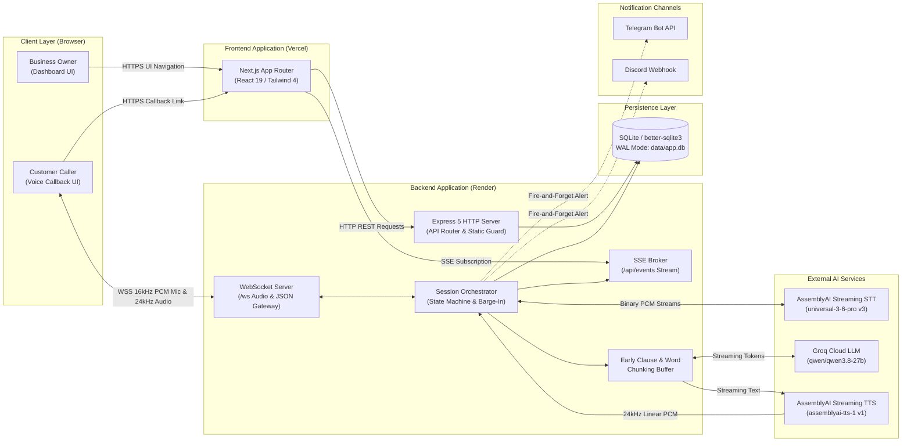
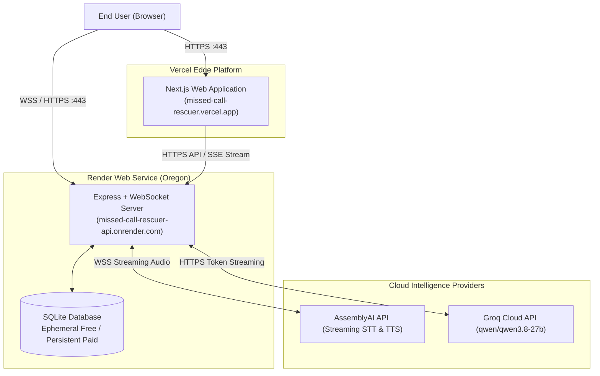

# Missed-Call Rescuer

**Missed-Call Rescuer** converts an unhandled missed call into an immediate, browser-based voice callback session. An intelligent automated voice assistant calls the customer back in their browser, ascertains their intent, answers common business questions within strict bounds, and generates a structured summary for the business owner dashboard with instant notification dispatch.

[](LICENSE)
[](https://nextjs.org/)
[](https://react.dev/)
[](https://nodejs.org/)
[](https://expressjs.com/)
[](https://www.typescriptlang.org/)
[](https://tailwindcss.com/)

**Live Application**: [https://missed-call-rescuer.vercel.app](https://missed-call-rescuer.vercel.app)  
**Source Code Repository**: [https://github.com/shobhitsahani/Missed-Call-Rescuer](https://github.com/shobhitsahani/Missed-Call-Rescuer)  
**Backend API / Health Check**: [https://missed-call-rescuer-api.onrender.com/api/health](https://missed-call-rescuer-api.onrender.com/api/health)  
**Architecture & Design Guide**: [docs/ARCHITECTURE.md](docs/ARCHITECTURE.md)

---

## Interface Preview

### Business Owner Dashboard
Real-time call tracking, instant metric cards, turn-by-turn drawer inspection, and full transcript downloads.


### Customer Voice Callback Interface
Low-latency full-duplex conversational voice interface with live interim transcription and visual agent states.


### Business Settings & Neural Voice Preview
Custom business operating hours, service catalogs, tone settings, and live audio preview for 10+ AssemblyAI neural voices.


---

## Product Overview

### The Problem
When prospective customers reach out to small service businesses (plumbers, electricians, HVAC, dental clinics, auto repair shops) and encounter voicemail or an unanswered phone, **over 80% do not leave a message**—they immediately call a competitor. For a small trade business, a single missed call can represent thousands of dollars in lost revenue.

### The Solution
**Missed-Call Rescuer** bridges the gap between a missed inbound inquiry and owner follow-up:
1. Logs the missed call event and issues a secure, unguessable callback session link.
2. The caller opens the link in their web browser and is greeted by a responsive voice assistant speaking on behalf of the business.
3. The assistant identifies customer urgency, answers questions strictly from the business profile (hours, services, FAQs), and captures callback details.
4. On call completion, the assistant generates a structured JSON summary (intent, urgency, sentiment, callback details, suggested actions).
5. The owner dashboard updates instantly via Server-Sent Events (SSE), and a plain-text alert is dispatched to the owner's Telegram or Discord channel.

### System Scope & Operational Reality

| Capability | Current Status | Details |
|---|---|---|
| **Voice Conversation** | Implemented (Browser) | Full-duplex voice streaming over WebSockets via Web Audio API & AudioWorklet. |
| **PSTN / Carrier Telephony** | Out of Scope / Planned | No SIP trunking or PSTN carriers (Twilio/Telnyx). Calls run inside modern desktop/mobile web browsers. |
| **Missed-Call Ingestion** | Implemented (Simulated/API) | Created via dashboard simulation button or HTTP API (`POST /api/missed-calls/simulate`). |
| **Outbound Dialer Daemon** | Scaffolded | `callback_jobs` rows are created and tracked in SQLite; automated telephony dialer background workers are not currently implemented. |
| **Owner Notifications** | Implemented | Fire-and-forget dispatch to Telegram Bot API or Discord Webhook. |
| **Tenancy Model** | Single Business Demo | Pre-configured profile (`Acme Plumbing`) with customizable settings. Multi-tenant customer accounts are not currently implemented. |

---

## User Journey

```
 ┌────────────────┐       ┌────────────────┐       ┌────────────────┐       ┌────────────────┐
 │ 1. Simulate    │       │ 2. Launch      │       │ 3. Voice       │       │ 4. Structured  │
 │    Missed Call ├──────>│    Callback    ├──────>│    Dialogue    ├──────>│    Summary &   │
 │   (Dashboard)  │       │    (/call/:tk) │       │   (WebSocket)  │       │   Notification │
 └────────────────┘       └────────────────┘       └────────────────┘       └───────┬────────┘
                                                                                    │
                                  ┌────────────────┐       ┌────────────────┐       │
                                  │ 6. Owner Alert │       │ 5. Real-Time   │<──────┘
                                  │   (Telegram /  │<──────┤    Dashboard   │
                                  │    Discord)    │       │   (SSE Stream) │
                                  └────────────────┘       └────────────────┘
```

1. **Simulate Missed Call**: The business owner or evaluator clicks **"Simulate missed call"** in the dashboard header.
2. **Launch Callback**: The backend creates a missed-call record with a 128-bit unguessable token valid for 30 minutes (`/call/[token]`).
3. **Voice Dialogue**: The caller opens the link in Chrome, grants microphone access, and converses with the assistant. Audio is downsampled to 16 kHz PCM in an AudioWorklet and streamed over WebSocket to AssemblyAI Streaming STT.
4. **Structured Summary**: Upon call conclusion or polite sign-off, the Groq LLM extracts a structured JSON summary validating urgency, sentiment, intent, and callback contact info.
5. **Real-Time Dashboard**: The dashboard refreshes immediately via Server-Sent Events (`/api/events`) displaying honest completion indicators, turn playback, and latency metrics.
6. **Owner Alert**: If configured, an instant plain-text notification is delivered to the business owner via Telegram or Discord with masked caller information.

---

## High-Level Architecture

The following diagram illustrates the primary components, data transports, and boundaries of Missed-Call Rescuer:



---

## Feature Overview

### Voice Experience
- **In-Browser Duplex Voice Session**: Low-latency bidirectional audio streaming using WebSockets.
- **AudioWorklet PCM Capture**: Raw microphone audio is captured and downsampled to 16 kHz mono linear PCM (`pcm_s16le`) in a dedicated browser audio thread ([public/audio-processor.js](public/audio-processor.js)).
- **Web Audio 24 kHz Playback**: Agent speech chunks received over WebSocket are decoded and scheduled gaplessly through the Web Audio API.
- **Server-Side Barge-In Detection**: Evaluates interim word counts (>= 2 words) and minimum speech duration (>= 400 ms) combined with a Jaccard self-speech similarity filter (<= 0.6 overlap) to prevent speaker feedback from triggering false interruptions.

### AI & Conversation Processing
- **AssemblyAI Streaming STT (v3)**: High-speed speech recognition using `universal-3-6-pro` with word-level timestamps and endpointing silence thresholds.
- **Groq Fast LLM Inference**: Sub-second time-to-first-token using `qwen/qwen3.8-27b` over an OpenAI-compatible API.
- **AssemblyAI Streaming TTS (v1)**: Expressive neural voice synthesis generating 24 kHz linear PCM audio.
- **Early Clause Chunking**: Streams early sentence fragments (>= 6 words or punctuation boundaries `,`, `;`, `:`, `—`) to TTS to minimize turnaround latency.
- **Prompt Safety Guard**: Assistant strictly introduces itself as automated, limits responses to one sentence under 20 words, never quotes unlisted prices, and refuses booking commitments without owner review.
- **Opt-Out & Wrong-Number Handling**: Detects customer opt-out requests (`"stop calling"`, `"remove me"`) or wrong-number statements, politely signs off, and updates records accordingly.

### Call History & Summaries
- **Strict Structured Summarization**: Extracts caller intent, urgency level (`low`, `medium`, `high`), preferred callback time, contact details, suggested actions, and sentiment (`positive`, `neutral`, `negative`).
- **Interactive Call Drawer**: Inspect call timestamps, dialogue turns, interruption flags, and latency measurements.
- **Transcript Export**: Download full transcripts in clean formatted TXT or structured JSON.

### Dashboard & Analytics
- **Real-Time SSE Streaming**: Live updates without page reloads on missed call creation, call termination, and summary completion.
- **Honest Completion Metrics**: Evaluates true call completions requiring customer engagement, valid summary extraction, and absence of error terminations.
- **Turnaround Latency Tracking**: Real-time display of Turn Detection, LLM Time-to-First-Token, and TTS Time-to-First-Audio.
- **Searchable TanStack Table**: Sort, filter, and paginate through missed calls and historical sessions.

### Owner Notifications
- **Multi-Provider Alerting**: Automatic dispatch to Telegram Bot API or Discord Webhook.
- **Data Sanitization**: Phone numbers are masked (`+1 ******1234`), API credentials redacted, and message lengths bounded.
- **Manual Resend & Test Hooks**: Test notification delivery directly from the dashboard or re-trigger alerts for existing calls.

### Security & Resource Limits
- **128-Bit Unguessable Tokens**: Callback URLs use high-entropy random hex tokens (`crypto.randomBytes(16)`).
- **Single-Use & Expiry**: Links expire after 30 minutes and reject reuse after call initiation.
- **CORS & WebSocket Origin Enforcement**: Validates inbound requests against `ALLOWED_ORIGINS`.
- **Budget Protection**: Enforces concurrency caps (`MAX_CONCURRENT_CALLS=2`), daily limits (`MAX_CALLS_PER_DAY=100`), and maximum call durations (`MAX_CALL_SECONDS=300`).
- **Admin Endpoint Gating**: Destructive actions (`/api/admin/clear-test-data`) require an explicit `ADMIN_TOKEN` in production.

---

## Technology Stack

| Layer | Technology | Version | Purpose |
|---|---|---|---|
| **Frontend Framework** | Next.js App Router | `16.4.3` | React Server Components, client routing, layout architecture |
| **Frontend UI Library** | React / React DOM | `19.3.0` | Declarative user interface components |
| **Styling & Design System** | Tailwind CSS / Radix UI | `^4.0` / `^1.3` | Utility styling, accessible dialogs, drawers, and tooltips |
| **Tables & Visualizations** | TanStack Table / Recharts | `^8.21` / `^3.10` | Sortable data tables and latency charts |
| **Backend Runtime** | Node.js with tsx | Node `20+` | Server runtime with native TypeScript execution |
| **HTTP Framework** | Express | `^5.3.0` | REST API routes, middleware, and static asset delivery |
| **WebSocket Engine** | ws | `^8.22.0` | Real-time bidirectional audio and event streaming |
| **Speech-to-Text** | AssemblyAI Streaming STT | `universal-3-6-pro` | Real-time speech recognition and turn detection (v3 WS) |
| **Text-to-Speech** | AssemblyAI Streaming TTS | `v1 WebSocket` | Streaming neural voice synthesis at 24 kHz |
| **LLM Provider** | Groq / OpenAI SDK | `^7.45.1` | Ultra-fast token streaming (`qwen/qwen3.8-27b`) |
| **Database** | SQLite via better-sqlite3 | `^13.0.3` | Local relational persistence with WAL journal mode |
| **Notifications** | Native fetch HTTP | Node built-in | Dispatches plain-text alerts to Telegram and Discord |

---

## Quick Start Guide

### Prerequisites
- **Node.js**: Version 20.0.0 or higher.
- **npm**: Version 9.0.0 or higher.
- **Browser**: Google Chrome recommended (AudioWorklet and Web Audio API tested; headphones recommended to eliminate microphone feedback).
- **API Keys**:
  - AssemblyAI API Key ([AssemblyAI Console](https://www.assemblyai.com/))
  - Groq API Key ([Groq Console](https://console.groq.com/)) or OpenAI API Key

### Local Installation

1. **Clone the repository**:
   ```bash
   git clone https://github.com/shobhitsahani/Missed-Call-Rescuer.git
   cd Missed-Call-Rescuer
   ```

2. **Install dependencies**:
   ```bash
   npm install --include=dev
   ```
   *(Note: `tsx` is a devDependency used to run TypeScript server scripts).*

3. **Configure environment variables**:
   ```bash
   cp .env.example .env
   ```
   Edit `.env` and fill in your API credentials:
   ```env
   ASSEMBLYAI_API_KEY=your_assemblyai_api_key_here
   OPENAI_API_KEY=gsk_your_groq_api_key_here
   OPENAI_BASE_URL=https://api.groq.com/openai/v1
   OPENAI_MODEL=qwen/qwen3.8-27b
   ALLOWED_ORIGINS=http://localhost:3010
   NEXT_PUBLIC_API_BASE=http://localhost:4000
   ```

4. **Start the development servers**:
   ```bash
   npm run dev
   ```
   This starts both processes concurrently:
   - **Frontend Dashboard**: [http://localhost:3010](http://localhost:3010)
   - **Backend API & WebSocket**: [http://localhost:4000](http://localhost:4000)

5. **Verify health endpoint**:
   ```bash
   curl http://localhost:4000/api/health
   ```
   Expected response:
   ```json
   {
     "ok": true,
     "components": {
       "database": { "status": "ok" },
       "tts": { "status": "ok", "apiKey": "configured", "voiceId": "aai-jane" },
       "stt": { "status": "ok", "apiKey": "configured", "model": "universal-3-6-pro" },
       "llm": { "status": "ok", "apiKey": "configured", "model": "qwen/qwen3.8-27b" }
     }
   }
   ```

### Troubleshooting Common Setup Issues

- **Microphone Blocked**: If Chrome shows a permission error, click the padlock or tune icon in the address bar and set Microphone to **Allow**, then refresh the callback page.
- **Port In Use (4000 or 3010)**: If port 4000 is occupied, set `PORT=4005` in `.env` and update `NEXT_PUBLIC_API_BASE=http://localhost:4005`.
- **Audio Feedback / Echo Interruption**: Headphones are strongly advised during local testing. Speaker audio leaking into the microphone can cause barge-in cancellation.
- **Missing API Keys**: If `ASSEMBLYAI_API_KEY` or `OPENAI_API_KEY` are unset, voice calls will fail with a configuration notice.

---

## Environment Variables Reference

| Variable | Description | Required? | Configured On | Secret? | Default / Example |
|---|---|---|---|---|---|
| `NEXT_PUBLIC_API_BASE` | Public HTTPS/HTTP URL of backend API | Yes (Web) | Vercel & `.env` | No | `http://localhost:4000` |
| `PORT` | Backend HTTP & WebSocket port | No | Backend (`.env`) | No | `4000` |
| `NODE_ENV` | Application environment mode | No | Both | No | `development` / `production` |
| `ALLOWED_ORIGINS` | Permitted CORS & WebSocket origins (comma-separated) | Yes (Prod) | Backend | No | `http://localhost:3010,https://missed-call-rescuer.vercel.app` |
| `ASSEMBLYAI_API_KEY` | AssemblyAI credential for Streaming STT & TTS | Yes | Backend | **Yes** | `aai_xxxxxxxxxxxxxx` |
| `ASSEMBLYAI_VOICE_ID` | Default neural voice model identifier | No | Backend | No | `aai-jane` |
| `ASSEMBLYAI_SPEECH_MODEL` | Streaming speech-to-text recognition model | No | Backend | No | `universal-3-6-pro` |
| `STT_PROVIDER` | Speech recognition engine (`assemblyai` or `browser`) | No | Backend | No | `assemblyai` |
| `OPENAI_API_KEY` | LLM API key (Groq, OpenAI, or OpenRouter) | Yes | Backend | **Yes** | `gsk_xxxxxxxxxxxxxx` |
| `GROQ_API_KEY` | Optional Groq key (takes precedence when set) | No | Backend | **Yes** | `gsk_xxxxxxxxxxxxxx` |
| `OPENROUTER_API_KEY` | Optional OpenRouter key fallback | No | Backend | **Yes** | `sk-or-v1-xxxxxxxxxxxx` |
| `OPENAI_BASE_URL` | Base URL for OpenAI-compatible endpoint | Yes (Groq) | Backend | No | `https://api.groq.com/openai/v1` |
| `OPENAI_API_BASE` | Alternative alias for `OPENAI_BASE_URL` | No | Backend | No | `https://api.groq.com/openai/v1` |
| `OPENAI_MODEL` | Model identifier for conversation & summary | No | Backend | No | `qwen/qwen3.8-27b` |
| `FIRST_CHUNK_MIN_WORDS` | Minimum words before early TTS chunk dispatch | No | Backend | No | `6` |
| `DB_PATH` | Path to persistent SQLite database file | No | Backend | No | `./data/app.db` |
| `MAX_CONCURRENT_CALLS` | Cap on simultaneous active voice sessions | No | Backend | No | `2` |
| `MAX_CALLS_PER_DAY` | Daily budget limit for total voice sessions | No | Backend | No | `100` |
| `MAX_CALL_SECONDS` | Maximum allowed duration per call in seconds | No | Backend | No | `300` (5 minutes) |
| `ADMIN_TOKEN` | Bearer secret for admin endpoints in production | No (Prod) | Backend | **Yes** | `adm_secret_token_here` |
| `NOTIFY_PROVIDER` | Owner alert service (`telegram`, `discord`, `none`) | No | Backend | No | `none` |
| `TELEGRAM_BOT_TOKEN` | Telegram Bot API authentication token | If Telegram | Backend | **Yes** | `123456789:ABCdef...` |
| `TELEGRAM_CHAT_ID` | Telegram chat ID for owner alerts | If Telegram | Backend | **Yes** | `123456789` |
| `DISCORD_WEBHOOK_URL` | Discord webhook execution URL | If Discord | Backend | **Yes** | `https://discord.com/api/webhooks/...` |
| `DASHBOARD_URL` | Base URL used in notification call links | No | Backend | No | `http://localhost:3010` |

> [!WARNING]
> **Client Security Invariant**: Variables prefixed with `NEXT_PUBLIC_` are bundled into client-side browser JavaScript. Never prefix API keys, bot tokens, or database paths with `NEXT_PUBLIC_`.

---

## Testing & Quality Checks

The repository includes a comprehensive automated test and verification suite:

```bash
# Type checking
npm run typecheck

# Linting
npm run lint

# Secret exposure & credential leak scan
npm run check:secrets

# Security & hardening regression suite (spawns isolated test server on :4098)
npm run test:security

# Unit test suite (WAV builder, transcript formatting, platform detection, phone collection policy)
npm test

# Voice preview cancellation regression test
npm run test:preview

# Reconnection test
npm run test:reconnect

# Auto-termination & playback-completion handshake regression suite
npm run test:termination

# Production build validation
npm run build
```

### Test Requirements Matrix

| Test Command | Scope | Requires Live Server? | Requires Cloud Keys? |
|---|---|---|---|
| `npm run typecheck` | Full repository TypeScript compilation | No | No |
| `npm run lint` | ESLint rules across frontend and backend | No | No |
| `npm run check:secrets` | Scans git history and source files for leaked keys | No | No |
| `npm run test:security` | 15 security regression tests (CORS, tokens, budgets) | Self-spawning (:4098) | No |
| `npm test` | Core unit suites + settings validation | Yes (:4000) for settings test | No |
| `npm run test:preview` | Tests client abort and socket release on voice preview | Self-spawning (:4098) | No |
| `npm run test:reconnect` | Tests token reconnect grace period | Self-spawning (:4098) | No |
| `npm run test:termination` | 10 auto-termination regression tests (goodbye classification, finalization state, playback_complete handshake, late speech rejection, bounded fallback timer) | Self-spawning (:4125) | No |
| `npm run test:e2e` | Live voice workflow end-to-end evaluation | Self-spawning | **Yes** (`ASSEMBLYAI_API_KEY`, `OPENAI_API_KEY`) |

---

## Deployment Architecture

The production deployment is decoupled into a static/SSR frontend hosted on Vercel and a persistent stateful API and WebSocket worker hosted on Render.



### 1. Frontend on Vercel
- **Root Directory**: `.` (Repository root)
- **Framework Preset**: Next.js
- **Build Command**: `next build`
- **Output Directory**: `.next`
- **Required Environment Variables**:
  - `NEXT_PUBLIC_API_BASE`: `https://missed-call-rescuer-api.onrender.com`

### 2. Backend on Render (`render.yaml`)
- **Service Type**: Web Service (Node.js)
- **Plan**: Free (or Starter with Persistent Disk)
- **Build Command**: `npm install --include=dev`
- **Start Command**: `npx tsx server/index.ts`
- **Health Check Path**: `/api/health`
- **Filesystem Persistence Note**:
  - Render free tier instances operate on an **ephemeral disk**. SQLite data survives in-place process restarts but is cleared upon instance redeployment or sleep wake-up.
  - To retain permanent historical records, attach a Render persistent disk mounted at `/var/data` and configure `DB_PATH=/var/data/app.db`.
- **Free-Tier Cold Starts**: Render free instances spin down after 15 minutes of inactivity. An initial wake-up request may take 30–60 seconds. The frontend features built-in retry handling and status indicators to guide evaluators during cold starts.

---

## Security & Privacy

Missed-Call Rescuer is hardened with targeted safeguards suitable for public demonstration and evaluation:

- **Opaque 128-Bit Tokens**: Callback URLs utilize unguessable 32-character hexadecimal tokens (`crypto.randomBytes(16)`). Legacy guessable database IDs (`mc_...`) are rejected by both HTTP endpoints and WebSocket joins.
- **Single-Use Enforcement**: Callback tokens are atomically marked when a call starts. Concluded calls cannot be joined a second time.
- **30-Minute Expiration**: Tokens expire automatically 30 minutes after creation with an HTTP 410 Gone status.
- **Strict Origin Checking**: CORS policies and WebSocket connection upgrades enforce `ALLOWED_ORIGINS`. Unauthorized cross-origin WebSocket connections are rejected with HTTP 403 Forbidden.
- **Data Minimization & Phone Masking**: Public Server-Sent Events (SSE) and `/api/missed-calls` omit callback tokens from broadcast payloads and mask customer phone numbers (`+1 ******1234`).
- **Resource Budgeting**: Server safeguards protect upstream provider credit limits with concurrency caps (`MAX_CONCURRENT_CALLS=2`), daily limits (`MAX_CALLS_PER_DAY=100`), and duration timers (`MAX_CALL_SECONDS=300`).
- **Admin Gating**: Destructive endpoints (`/api/admin/clear-test-data`) require `ADMIN_TOKEN` via the `x-admin-token` header when deployed in production.
- **Plain-Text Notifications**: Owner notifications avoid Markdown or HTML parse modes, eliminating markup breakage or injection vulnerabilities.

> [!NOTE]
> **Open Demonstration Mode**: To facilitate frictionless evaluation by hackathon judges, dashboard overview and historical call views are publicly accessible without user logins. Phone masking and token secrecy protect customer identities, but this configuration is not intended as a multi-tenant enterprise deployment.

---

## Latency & Turnaround Time

Turnaround latency represents the total elapsed time from the moment the customer stops speaking to the arrival of the first playable audio byte. Benchmarks measured across automated evaluation runs using streaming PCM audio against upstream AssemblyAI and Groq cloud APIs ([scripts/verify-pipeline.ts](scripts/verify-pipeline.ts)):

| Pipeline Stage | Measured Average | Range | Description |
|---|---|---|---|
| **Turn Detection** (`turnDetectionMs`) | **289 ms** | 254–336 ms | Elapsed time from customer silence to AssemblyAI `end_of_turn: true` |
| **LLM First Token** (`llmFirstTokenMs`) | **1,356 ms** | 1,239–1,506 ms | Time from `end_of_turn` to first token streamed from Groq |
| **TTS First Audio** (`ttsFirstAudioMs`) | **365 ms** | 340–439 ms | Time from `Generate` command to first audio chunk from AssemblyAI TTS |
| **Total Processing Pipeline** (`totalMs`) | **1,747 ms** | 1,627–1,906 ms | Elapsed time from `end_of_turn` arrival to first playable audio byte |
| **Total End-to-End Turnaround** | **2,036 ms** | 1,881–2,242 ms | Customer silence to first heard audio (including turn detection) |

---

## Known Limitations

- **Browser-Only Voice Transport**: Calls execute exclusively within the web browser via WebSockets and Web Audio. There is no physical carrier integration (PSTN/SIP) to dial telephone handsets.
- **Callback Job Queue**: Rows are created and logged in `callback_jobs`, but an automated background dialing daemon is not currently active.
- **In-Memory Session Orchestration**: Active call state (buffers, timers, provider clients) resides in server process memory. Multi-instance scaling requires sticky sessions or an external Redis state store.
- **Ephemeral Storage on Free Tier**: Render free tier disk is ephemeral; historical calls reset on redeployment unless a persistent disk is attached.
- **Single Business Seed**: The database seeds a single business profile (`Acme Plumbing`); multi-business organizational tenancy is not implemented.
- **Provider Cold-Starts & Rate Limits**: Upstream cloud AI providers enforce concurrency limits; free tier Render instances sleep after 15 minutes of inactivity.

---

## Documentation & References

- **System Architecture & High-Level Design**: [docs/ARCHITECTURE.md](docs/ARCHITECTURE.md)
- **Submission & Video Shot List**: [docs/SUBMISSION.md](docs/SUBMISSION.md)
- **License Agreement**: [LICENSE](LICENSE)

---

## License & Credits

- **License**: Released under the [MIT License](LICENSE).
- **Speech-to-Text**: Powered by [AssemblyAI Streaming STT](https://www.assemblyai.com/) (`universal-3-6-pro`).
- **Text-to-Speech**: Powered by [AssemblyAI Streaming TTS](https://www.assemblyai.com/) (`assemblyai-tts-1`).
- **LLM Inference**: Powered by [Groq](https://groq.com/) (`qwen/qwen3.8-27b`).
