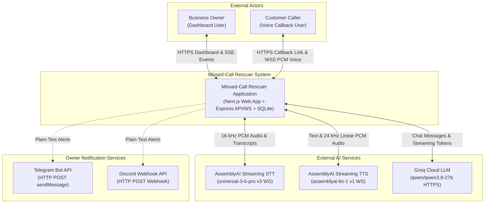
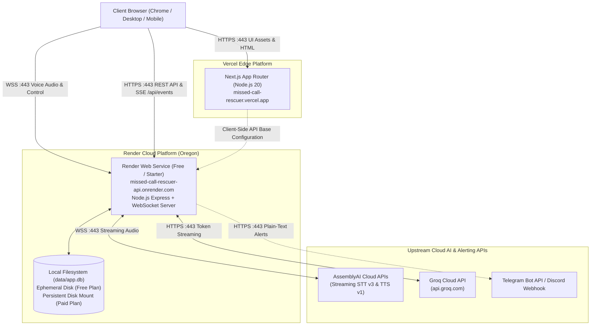
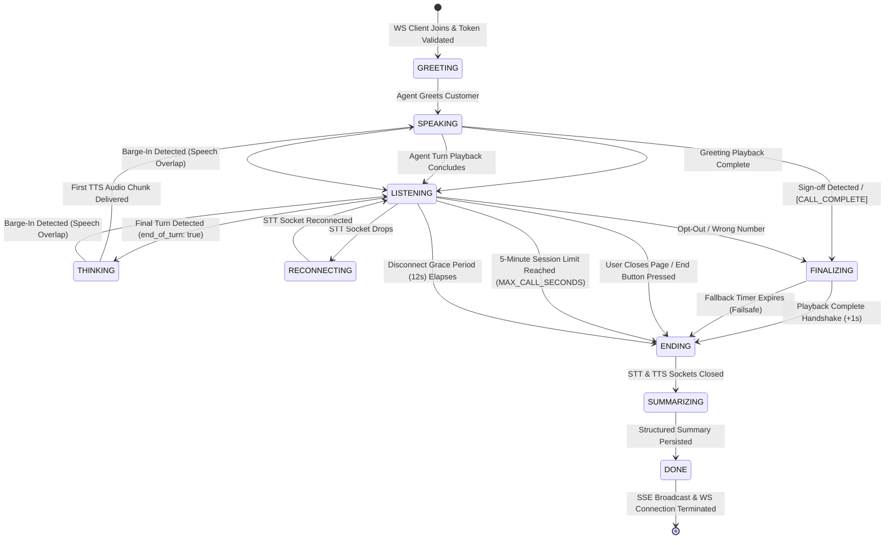
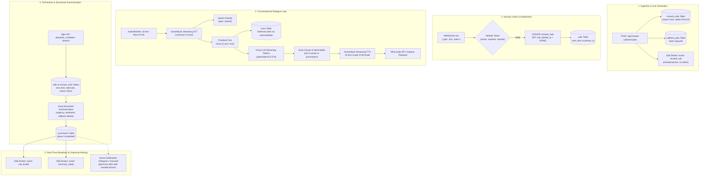
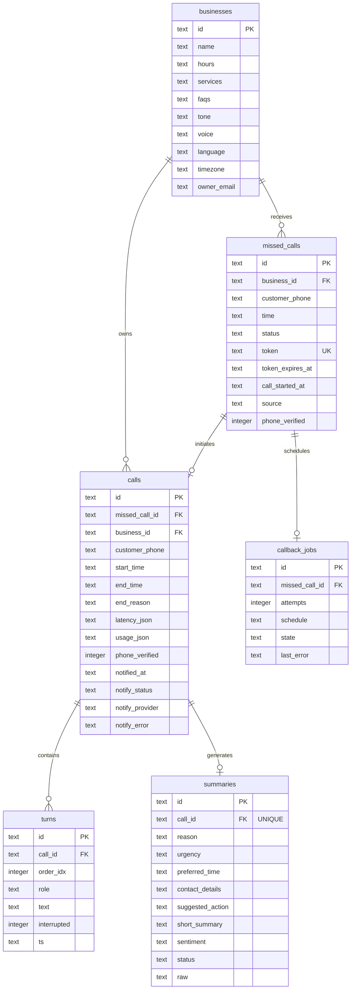
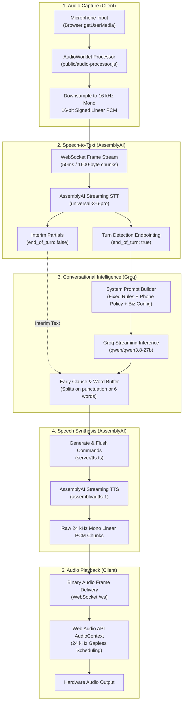

# Missed-Call Rescuer — System Architecture and High-Level Design

## Table of Contents
1. [Document Metadata](#1-document-metadata)
2. [Executive Summary](#2-executive-summary)
3. [Goals and Non-Goals](#3-goals-and-non-goals)
4. [System Context Diagram](#4-system-context-diagram)
5. [High-Level Design (HLD)](#5-high-level-design-hld)
6. [Deployment Architecture](#6-deployment-architecture)
7. [Core Component Responsibilities](#7-core-component-responsibilities)
8. [Voice Conversation Sequence Diagram](#8-voice-conversation-sequence-diagram)
9. [Call Lifecycle and State Machine](#9-call-lifecycle-and-state-machine)
10. [Data Flow and Persistence](#10-data-flow-and-persistence)
11. [API and Real-Time Communication Design](#11-api-and-real-time-communication-design)
12. [AI Voice Pipeline](#12-ai-voice-pipeline)
13. [Error Handling and Reliability](#13-error-handling-and-reliability)
14. [Security Architecture](#14-security-architecture)
15. [Scalability and Performance](#15-scalability-and-performance)
16. [Deployment and Configuration](#16-deployment-and-configuration)
17. [Architecture Decisions and Trade-Offs (ADR Summary)](#17-architecture-decisions-and-trade-offs-adr-summary)
18. [Known Limitations and Future Evolution](#18-known-limitations-and-future-evolution)
19. [Glossary](#19-glossary)

---

## 1. Document Metadata

| Attribute | Details |
|---|---|
| **Document Purpose** | Comprehensive architectural specification and high-level design document for Missed-Call Rescuer |
| **Project** | Missed-Call Rescuer |
| **Current Status** | Implementation Documentation (Verified against production codebase) |
| **Last Reviewed Date** | 2026-11-03 |
| **Scope** | Complete system architecture: frontend web app, backend server, WebSocket audio gateway, AI voice pipeline, database schema, security policies, and deployment topology |
| **Intended Audience** | Systems architects, backend and full-stack software engineers, hackathon evaluators, and prospective contributors |

---

## 2. Executive Summary

**Missed-Call Rescuer** is an automated voice callback agent engineered for small service and trade businesses (e.g., plumbing, electrical, HVAC, automotive, medical clinics). When an inbound customer call cannot be answered, the system registers the missed call, issues a secure, single-use callback URL (`/call/{token}`), and conducts a low-latency conversational voice session directly inside the customer's browser.

During the voice interaction, the assistant introduces itself as an automated agent, addresses inquiries strictly within configured business bounds (hours, services, FAQs), gathers caller requirements, and accepts interruptions via server-side barge-in detection. Upon call termination, the system extracts a structured JSON summary (intent, urgency level, sentiment, contact details, suggested actions), persists the conversation history to an SQLite database, streams real-time updates to the owner dashboard via Server-Sent Events (SSE), and dispatches an instant plain-text alert to the business owner via Telegram or Discord.

The system is deployed as a dual-host architecture: a Next.js App Router frontend hosted on Vercel and a stateful Node.js/Express WebSocket server hosted on Render.

---

## 3. Goals and Non-Goals

### System Goals
- **Sub-2-Second Turnaround Latency**: Deliver an conversational turnaround time (~1.7s pipeline processing, ~2.0s end-to-end including speech endpointing silence) using streaming WebSockets and early clause chunking.
- **In-Browser Audio Fidelity**: Capture 16 kHz linear PCM microphone audio via browser AudioWorklet and deliver 24 kHz gapless neural speech playback using the Web Audio API.
- **Strict Conversational Guardrails**: Constrain LLM responses to concise single-sentence answers (< 20 words) derived strictly from configured business data, prohibiting hallucinations, booking commitments, or unlisted price estimates.
- **Server-Side Barge-In Detection**: Instantly cancel speech synthesis and in-flight LLM token generation when customer speech is detected, filtered with a self-speech similarity guard to eliminate audio feedback loops.
- **Structured Intent Extraction**: Guarantee post-call extraction of structured JSON summaries with urgency grading (`low`, `medium`, `high`) and fallback to an unavailable status state on provider failure.
- **Resource & Budget Safeguards**: Enforce strict concurrency limits, daily session caps, session duration timers, and rate limiting to protect upstream AI provider allowances.
- **Data Minimization & Privacy**: Mask customer telephone numbers on public APIs, Server-Sent Events, and outbound owner notifications.

### Explicit Non-Goals
- **Direct PSTN / Carrier Telephony**: The system does not interface with physical telecommunications networks, SS7, SIP trunks, or carrier dialers (e.g., Twilio Voice, Telnyx). All voice sessions execute in the browser.
- **Automated Outbound Calling Daemon**: While `callback_jobs` rows are enqueued in SQLite, automated background dialing workers are not currently implemented.
- **Multi-Tenant Enterprise Isolation**: The demo environment operates in open hackathon evaluation mode with a single seeded business profile (`Acme Plumbing`). Organization-level customer authentication and tenant data isolation are not present.
- **Regulatory Compliance Guarantees**: Phone number masking and tokenization provide baseline evaluation privacy; the application is not certified for HIPAA, PCI-DSS, or GDPR compliance.

---

## 4. System Context Diagram

The following Mermaid diagram shows the Missed-Call Rescuer system boundary, external actors, and third-party integrations:



### Contextual Actor Descriptions
- **Business Owner**: Configures business profiles (hours, services, FAQs, voice selection, tone), simulates missed calls, inspects real-time dashboard metrics, listens to turn-by-turn dialogue, downloads transcripts, and receives instant mobile alerts.
- **Customer Caller**: Accesses the unique callback link via mobile or desktop browser, grants microphone permissions, listens to the automated greeting, speaks naturally, and describes their service request.
- **AssemblyAI Streaming STT**: Upstream WebSocket service converting 16 kHz raw microphone PCM into real-time partial transcripts and finalized turns with word-level timestamps.
- **AssemblyAI Streaming TTS**: Upstream WebSocket service synthesizing neural agent speech chunks at 24 kHz mono linear PCM.
- **Groq Cloud LLM**: High-throughput OpenAI-compatible endpoint streaming conversational completions and extracting structured summaries.
- **Telegram / Discord**: Third-party messaging platforms receiving plain-text callback summaries with masked customer contact data.

---

## 5. High-Level Design (HLD)

The system architecture is structured across four distinct layers:

```mermaid
flowchart LR
    subgraph Presentation ["Presentation Layer (Browser)"]
        UI_Dash["Owner Dashboard\n(src/app/page.tsx)"]
        UI_Call["Customer Call UI\n(src/app/call/[token]/page.tsx)"]
        Worklet["AudioWorklet Processor\n(public/audio-processor.js)"]
        WebAudio["Web Audio Playback\n(24 kHz AudioContext)"]
    end

    subgraph Application ["Application Layer (Express / Node.js :4000)"]
        HTTP_API["Express HTTP API Router\n(server/index.ts)"]
        WS_Gate["WebSocket Gateway (/ws)\n(server/index.ts)"]
        SSE_Broker["SSE Event Broker\n(server/events.ts)"]
        Session_Orch["Session Orchestrator\n(server/session.ts)"]
        Chunk_Buffer["Early Clause & Word Buffer\n(server/session.ts)"]
        Sec_Guard["Security & Rate Limiter\n(server/security.ts)"]
        Notify_Svc["Notification Service\n(server/notify.ts)"]
    end

    subgraph Integration ["Integration Layer (Upstream Clients)"]
        STT_Client["AssemblyAI STT Client\n(server/stt.ts)"]
        TTS_Client["AssemblyAI TTS Client\n(server/tts.ts)"]
        LLM_Client["OpenAI / Groq Client\n(server/llm.ts)"]
    end

    subgraph Persistence ["Persistence Layer (Storage)"]
        SQLite_DB[("SQLite Database\n(WAL Mode: data/app.db)")]
    end

    UI_Dash -->|HTTP REST API| HTTP_API
    UI_Dash <-->|SSE Stream (/api/events)| SSE_Broker
    UI_Call <-->|WebSocket JSON Control| WS_Gate
    Worklet -->|Binary 16kHz PCM Frames| WS_Gate
    WS_Gate -->|Binary 24kHz PCM Chunks| WebAudio

    HTTP_API --> Sec_Guard
    WS_Gate --> Sec_Guard
    Sec_Guard --> Session_Orch

    Session_Orch <--> STT_Client
    Session_Orch --> Chunk_Buffer
    Chunk_Buffer <--> LLM_Client
    Chunk_Buffer <--> TTS_Client
    TTS_Client --> WS_Gate

    HTTP_API --> SQLite_DB
    Session_Orch --> SQLite_DB
    Session_Orch --> SSE_Broker
    Session_Orch -.-> Notify_Svc
```

### Layer Details

#### 1. Presentation Layer
- **Owner Dashboard (`src/app/page.tsx`)**: Next.js App Router interface displaying missed calls, historical call logs, completion statistics, rolling latency averages, and audio drawer inspection. Subscribes to `/api/events` via Server-Sent Events.
- **Customer Call Interface (`src/app/call/[token]/page.tsx`)**: Browser voice interface handling microphone initialization, token validation, visual agent state indicators, interim speech bubbles, and graceful call teardown.
- **AudioWorklet (`public/audio-processor.js`)**: Executes in a dedicated browser audio rendering thread. Downsamples microphone input from the hardware rate (typically 44.1 kHz or 48 kHz) to 16 kHz mono signed 16-bit linear PCM and posts binary buffers to the UI thread.
- **Web Audio Engine**: Maintains a 24 kHz `AudioContext` that queues and plays incoming linear PCM chunks gaplessly using sequential timestamp scheduling.

#### 2. Application Layer
- **Express HTTP Router (`server/index.ts`)**: Serves REST endpoints for business configuration, voice previews, missed-call simulations, call history, transcripts, and health checks.
- **WebSocket Gateway (`/ws`)**: Upgrades authorized incoming client connections, routes binary microphone frames directly to the STT client, and dispatches JSON control events.
- **Session Orchestrator (`server/session.ts`)**: State machine controlling call flow, timeouts, barge-in evaluation, turn persistence deferral, and summarization triggers.
- **Early Clause Chunking Buffer (`server/session.ts`)**: Inspects in-flight token streams from the LLM, slicing sentences on early punctuation or word boundaries (`FIRST_CHUNK_MIN_WORDS=6`) to trigger speech synthesis immediately.
- **Notification Service (`server/notify.ts`)**: Manages fire-and-forget plain-text message dispatch to Telegram or Discord with customer phone number masking.

#### 3. Integration Layer
- **AssemblyAI STT Client (`server/stt.ts`)**: Manages a persistent WebSocket connection to `wss://streaming.assemblyai.com/v3/ws`, emitting partial transcripts, finalized turns, and endpointing timestamps.
- **AssemblyAI TTS Client (`server/tts.ts`)**: Connects to `wss://tts.us.assemblyai.com/v1/ws`, streaming synthesis requests (`Generate`, `Flush`) and returning raw 24 kHz linear PCM audio buffers.
- **Groq LLM Client (`server/llm.ts`)**: Interfaces with Groq's high-speed endpoint (`qwen/qwen3.8-27b`) via the OpenAI SDK for streaming conversational dialogue and structured summary extraction.

#### 4. Persistence Layer
- **SQLite Engine (`server/db.ts`)**: Uses `better-sqlite3` configured with Write-Ahead Logging (`PRAGMA journal_mode = WAL`) and foreign key constraints enabled. Persists business settings, missed calls, queued callback jobs, calls, dialogue turns, and structured summaries.

---

## 6. Deployment Architecture

The production environment is separated into two cloud hosting providers:



### Infrastructure Details & Hosting Characteristics

| Component | Platform | Specification | Network Inbound | Storage Characteristics |
|---|---|---|---|---|
| **Frontend** | Vercel | Next.js 16.4.3 App Router | HTTPS (Port 443) | Stateless edge distribution |
| **Backend API & WS** | Render | Node.js Express 5 + `ws` | HTTPS & WSS (Port 443) | Ephemeral disk (Free) / Persistent Disk (`/var/data`, Paid) |
| **Database** | Render Instance | SQLite 3 via `better-sqlite3` | Local UNIX process I/O | WAL mode file at `DB_PATH` (`./data/app.db`) |

#### Render Free-Tier Constraints
- **Ephemeral Filesystem**: On Render free web services, the container filesystem is ephemeral. SQLite data survives in-place process restarts but is **wiped upon instance redeployment or server sleep cycles**. For permanent data retention, attach a Render persistent disk (paid tier) with mount path `/var/data` and configure `DB_PATH=/var/data/app.db`.
- **Inactivity Sleep & Cold Starts**: Free instances spin down after 15 minutes of zero inbound HTTP traffic. The initial request to wake the instance takes approximately **30 to 60 seconds**. The frontend accommodates this with an automated exponential retry loop and cold-start progress feedback.

---

## 7. Core Component Responsibilities

| Component | Responsibility | Interfaces | State Ownership | Implementation File |
|---|---|---|---|---|
| **Dashboard UI** | Renders business overview, call logs, completion metrics, and audio drawer | React 19, SSE (`/api/events`), HTTP REST | Client component state | [`src/app/page.tsx`](../src/app/page.tsx) |
| **Customer Call UI** | Manages microphone capture, AudioWorklet downsampling, and gapless audio playback | React 19, WebSocket (`/ws`), Web Audio API | Client call lifecycle state | [`src/app/call/[token]/page.tsx`](../src/app/call/%5Btoken%5D/page.tsx) |
| **Audio Worklet** | Downsamples microphone stream to 16 kHz mono linear signed 16-bit PCM | Web Audio AudioWorkletProcessor | Audio thread buffer | [`public/audio-processor.js`](../public/audio-processor.js) |
| **HTTP API Server** | Routes REST requests, validates origins, checks call budgets, and gates admin endpoints | Express 5, CORS middleware | Ephemeral cache & counters | [`server/index.ts`](../server/index.ts) |
| **WebSocket Server** | Upgrades incoming connections, handles token auth, and routes binary/JSON frames | `ws.WebSocketServer` | Socket connection mapping | [`server/index.ts`](../server/index.ts) |
| **Session Orchestrator** | Coordinates call state machine, barge-in cancellation, timers, and summaries | Event handlers, Async generators | Active session map (`Map<string, Session>`) | [`server/session.ts`](../server/session.ts) |
| **Streaming STT** | Manages upstream WebSocket connection to AssemblyAI v3 STT with auto-reconnect ring buffer | WebSocket, EventEmitter | Audio ring buffer (1.5s) | [`server/stt.ts`](../server/stt.ts) |
| **Streaming TTS** | Synthesizes agent speech chunks into 24 kHz linear PCM with generation tagging | WebSocket, AsyncGenerator | In-flight generation counter | [`server/tts.ts`](../server/tts.ts) |
| **LLM Inference** | Streams conversational replies and generates structured summaries | OpenAI SDK (`OpenAI.Chat`) | Ephemeral client instance | [`server/llm.ts`](../server/llm.ts) |
| **Database Layer** | Manages relational schema migrations, connection pragmas, and queries | `better-sqlite3` Database | SQLite file & WAL cache | [`server/db.ts`](../server/db.ts) |
| **Notification Service** | Formats and dispatches plain-text alerts to Telegram or Discord | Fetch API HTTP POST | Resend rate limit maps | [`server/notify.ts`](../server/notify.ts) |
| **SSE Broker** | Broadcasts real-time events to connected dashboard clients with heartbeat pings | Server-Sent Events (`res.write`) | Set of active HTTP client responses | [`server/events.ts`](../server/events.ts) |

---

## 8. Voice Conversation Sequence Diagram

The following Mermaid sequence diagram details a complete conversational turn, including token validation, audio capture, speech recognition, early clause chunking, speech synthesis, and post-call finalization:

```mermaid
sequenceDiagram
    autonumber
    actor Caller as Customer Caller
    participant Browser as Browser Client (AudioWorklet & Web Audio)
    participant Backend as Express / WS Gateway (server/index.ts)
    participant Session as Session Orchestrator (server/session.ts)
    participant STT as AssemblyAI STT v3 (server/stt.ts)
    participant LLM as Groq Cloud LLM (server/llm.ts)
    participant TTS as AssemblyAI TTS v1 (server/tts.ts)
    participant DB as SQLite Database (server/db.ts)
    participant SSE as SSE Broker (server/events.ts)

    Caller->>Browser: Opens /call/{token}
    Browser->>Backend: GET /api/call-token/{token}
    Backend->>DB: SELECT * FROM missed_calls WHERE token = ?
    Backend-->>Browser: HTTP 200 { valid: true, businessName, voice }
    Caller->>Browser: Clicks "Start Call" (Grants Mic Permission)
    Browser->>Backend: WS Upgrade /ws (Origin Verified)
    Browser->>Backend: JSON { type: "join", token: "{token}" }
    Backend->>Session: startSession(ws, token)
    Session->>DB: UPDATE missed_calls SET call_started_at = NOW()
    Session->>DB: INSERT INTO calls (id, missed_call_id, ...)
    Session->>TTS: connectWithRetry()
    Session->>STT: connectWithRetry()
    Session->>Browser: JSON { type: "state", state: "GREETING" }
    Session->>TTS: speak("Hi, this is an automated assistant calling on behalf of Acme Plumbing...")
    TTS-->>Session: Binary 24 kHz PCM Audio Chunks
    Session-->>Browser: Binary 24 kHz PCM Chunks
    Browser-->>Caller: Plays Greeting Audio
    Session->>Browser: JSON { type: "state", state: "LISTENING" }

    loop Conversational Turn
        Caller->>Browser: Speaks ("My kitchen sink is leaking")
        Browser->>Backend: Binary 16 kHz PCM Chunks (AudioWorklet)
        Backend->>STT: sendAudio(pcmChunk)
        STT-->>Session: Interim Turn (end_of_turn: false, "My kitchen...")
        Session-->>Browser: JSON { type: "partial", text: "My kitchen..." }
        STT-->>Session: Final Turn (end_of_turn: true, "My kitchen sink is leaking")
        Session->>Browser: JSON { type: "customer_transcript", text: "My kitchen sink is leaking" }
        Session->>Browser: JSON { type: "state", state: "THINKING" }
        Session->>LLM: streamChat(messages, businessConfig)
        LLM-->>Session: Tokens ("We can send a plumber today, [pause] ...")
        Note over Session: Early Clause Buffer matches comma or 6 words
        Session->>TTS: speak("We can send a plumber today,")
        TTS-->>Session: Binary 24 kHz PCM Audio Chunks
        Session->>Browser: JSON { type: "state", state: "SPEAKING" }
        Session->>Browser: JSON { type: "metrics", turnDetectionMs, llmFirstTokenMs, ttsFirstAudioMs, totalMs }
        Session-->>Browser: Binary 24 kHz PCM Audio Chunks
        Browser-->>Caller: Plays Agent Speech
        Session->>Browser: JSON { type: "state", state: "LISTENING" }
    end

    Note over Caller,Session: Customer signals wrap-up ("Thank you, that's all")
    Session->>LLM: streamChat(messages, businessConfig)
    LLM-->>Session: "Thank you for calling Acme Plumbing. Have a great day! [CALL_COMPLETE]"
    Session->>TTS: speak("Thank you for calling Acme Plumbing. Have a great day!")
    TTS-->>Session: Binary 24 kHz PCM Chunks
    Session-->>Browser: Binary 24 kHz PCM Chunks
    Session->>Browser: JSON { type: "state", state: "FINALIZING" }
    Session->>Browser: JSON { type: "agent_audio_end", isFinal: true }
    Browser-->>Caller: Plays final audio chunks to completion
    Browser->>Backend: JSON { type: "playback_complete" }
    Backend->>Session: handlePlaybackComplete(session)
    Note over Session: Cancels fallback timer; initiates 1s acoustic tail delay
    Note over Session: (Failsafe: Bounded fallback timer if client disconnects)
    Session->>Session: endSession(session, "assistant_ended")
    Session->>DB: UPDATE calls SET end_time = NOW(), latency_json, usage_json
    Session->>DB: UPDATE missed_calls SET status = 'done'
    Session->>Browser: JSON { type: "state", state: "SUMMARIZING" }
    Session->>STT: close()
    Session->>TTS: close()
    Session->>LLM: summarize(transcript, businessConfig)
    LLM-->>Session: Structured JSON Summary
    Session->>DB: INSERT INTO summaries (...)
    Session->>Browser: JSON { type: "summary", summary: {...} }
    Session->>Browser: JSON { type: "state", state: "DONE" }
    Session->>SSE: broadcast("call_ended", { callId })
    Session->>SSE: broadcast("summary_ready", { callId })
    Session-.->Backend: notifyCallSummary (Telegram / Discord)
    Session->>Browser: ws.close()
```

---

## 9. Call Lifecycle and State Machine

The session orchestrator transitions between explicit operational states throughout the lifespan of a call:



### State Definitions
- `GREETING`: Initializing session, verifying token, connecting upstream STT/TTS sockets, and preparing the opening greeting.
- `SPEAKING`: Transmitting 24 kHz PCM audio chunks to the browser client for playback.
- `LISTENING`: Awaiting caller audio input via AudioWorklet and AssemblyAI STT.
- `THINKING`: Ingesting streaming LLM tokens, buffering early clauses, and initiating TTS generation.
- `FINALIZING`: Terminal assistant turn has concluded; final audio chunks are streaming to the client.
- `RECONNECTING`: Upstream AssemblyAI STT connection experienced a transient drop; reconnecting with exponential backoff and replaying the 1.5s audio buffer.
- `ENDING`: Voice session finished; writing completion timestamps, latency metrics, and turn records to SQLite.
- `SUMMARIZING`: External STT and TTS sockets closed; executing LLM structured summary extraction with single-attempt retry.
- `DONE`: Summary persisted, payload broadcast to client, SSE events fired, and WebSocket cleanly closed.

### Barge-In & Interruption Guard Architecture
Interruption detection is performed on the server inside [`server/session.ts`](../server/session.ts) during `SPEAKING` and `THINKING` states:
1. **Word Threshold**: The incoming AssemblyAI partial transcript must contain at least **2 words**.
2. **Time Guard**: The assistant must have been speaking for at least **400 ms** to eliminate transient initial transients.
3. **Self-Speech Jaccard Similarity Filter**:
   ```typescript
   similar(interimCustomerText, currentAgentSpokenText)
   ```
   A word-overlap ratio is computed between the interim transcript and the agent's active spoken sentence. If the similarity exceeds **0.6 (60%)**, the speech is classified as acoustic feedback from laptop speakers and ignored.
4. **Cancellation Trigger**: If all criteria pass, `bargeIn(session)` fires:
   - Sets `session.cancelGeneration = true` and `session.generating = false`.
   - Aborts the in-flight LLM HTTP request via `session.abortController.abort()`.
   - Transmits a `{ type: "Cancel" }` frame to AssemblyAI TTS to drop queued synthesis.
   - Dispatches a `{ type: "stop_audio" }` frame to the browser to cut off local Web Audio playback.
   - Marks the interrupted agent turn in SQLite as `interrupted = 1`.
   - Transitions state immediately to `LISTENING`.

### Call Finalization & Goodbye Handshake
- **Closing Sign-Off Detection (`isFinalClosingTurn`)**: The system analyzes conversation context for explicit sign-off phrases (`"have a great day"`, `"thank you for calling"`, `"goodbye"`, `"bye"`) or internal LLM completion tokens (`[CALL_COMPLETE]`). It strictly verifies that the sentence does not end in a question mark.
- **Full-Duplex Playback Handshake**:
  - The server transitions to `FINALIZING` and emits `{ type: "agent_audio_end", isFinal: true }` once all synthesized audio chunks for the farewell message have been pushed into the WebSocket.
  - The browser client ([`src/app/call/[token]/page.tsx`](../src/app/call/%5Btoken%5D/page.tsx)) schedules and plays the queued linear PCM chunks through the Web Audio API. When the final scheduled source buffer completes playback (`src.onended`), it dispatches `{ type: "playback_complete" }` over the WebSocket.
  - The server receives `playback_complete` in `handlePlaybackComplete` ([`server/session.ts`](../server/session.ts)), cancels the failsafe timer, and sets a brief 1-second acoustic tail countdown before executing `endSession(session, "assistant_ended")`. This guarantees the caller hears every word of the sign-off with no abrupt truncation.
- **Bounded Fallback Protection**:
  - To prevent sessions from lingering indefinitely if the client disconnects, experiences packet loss, or closes the tab, the server starts a bounded fallback timer concurrently with `agent_audio_end`:
    ```typescript
    fallbackMs = Math.max(5000, audioDurationMs + 4000);
    ```
  - If the client's `playback_complete` message is received, this fallback timer is immediately cleared. If no acknowledgment arrives before `fallbackMs` elapses, the fallback timer forces session termination and initiates summarization automatically.

---

## 10. Data Flow and Persistence

### System Data Flow Diagram

The following Mermaid diagram traces the operational data lifecycle—from inbound missed-call ingestion and token creation, through real-time AudioWorklet audio processing, deferred turn persistence, LLM token streaming, structured summary extraction, and multi-channel SSE/webhook broadcast:



### Relational Entity-Relationship Diagram

The SQLite database schema ([`server/db.ts`](../server/db.ts)) consists of 6 tables with relational integrity:



### Data Lifecycle & Write Optimization
1. **Missed-Call Ingestion**: When `/api/missed-calls/simulate` is called, a record is inserted into `missed_calls` with `status = 'new'`, an unguessable 128-bit hex `token`, a 30-minute expiration timestamp, and an associated `callback_jobs` row.
2. **Call Initiation**: Upon WebSocket connection, the link is claimed atomically (`UPDATE missed_calls SET call_started_at = NOW() WHERE call_started_at IS NULL`). A `calls` row is inserted with `start_time`.
3. **Deferred Turn Persistence (`setImmediate`)**: During active conversation, customer turns are appended to the in-memory array immediately, while the SQLite `INSERT INTO turns` query is deferred to the next event-loop tick using `setImmediate(persist)`. This ensures that disk I/O never blocks the critical path to the LLM.
4. **Call Termination**: When the call concludes, `calls` is updated with `end_time`, `end_reason`, serialized `latency_json` arrays, and `usage_json` token/character counts. `missed_calls.status` transitions to `'done'` (or `'opted_out'`).
5. **Summary Persistence**: The structured JSON payload is inserted into `summaries` with `status = 'completed'` (or `'unavailable'`).
6. **Data Clearing**: Evaluators can purge test and demo records via `POST /api/admin/clear-test-data`. This deletes all records from `summaries`, `turns`, `calls`, `callback_jobs`, and `missed_calls`, while strictly preserving the `businesses` configuration table.

---

## 11. API and Real-Time Communication Design

### HTTP REST API Endpoints

| Method | Endpoint | Purpose | Access & Auth | Notes |
|---|---|---|---|---|
| `GET` | `/api/health` | Diagnostic health check | Public | Returns status of DB, STT, TTS, and LLM configuration |
| `GET` | `/api/call-token/:token` | Validates callback link metadata | Public | Validates 128-bit hex token, 30m expiry, and single-use |
| `GET` | `/api/business` | Returns active business settings | Public | Omits `owner_email` from public response |
| `PUT` | `/api/business` | Updates business settings | Public (Demo) | Validates length limits on name, hours, services, and FAQs |
| `GET` | `/api/business/voices` | Returns AssemblyAI neural voices catalog | Public | Returns list of 10+ supported neural voice models |
| `POST` | `/api/business/voice-preview` | Streams synthesized audio preview | Public (Rate-limited) | 24 kHz WAV audio with in-memory caching and client abort handling |
| `GET` | `/api/business/presets` | Returns catalog of business presets | Public | Built-in presets for trade and service businesses |
| `POST` | `/api/business/reset` | Resets business profile to preset | Public (Demo) | Replaces active config with preset values |
| `GET` | `/api/missed-calls` | Returns missed-call history | Public | Returns masked phone numbers; retains callback tokens |
| `POST` | `/api/missed-calls/simulate` | Simulates an inbound missed call | Rate-limited (5/min/IP) | Creates missed-call record and queues callback job |
| `GET` | `/api/calls` | Returns historical call list | Public | Includes honest `is_completed` calculation and parsed latency |
| `GET` | `/api/calls/:id` | Returns single call, turns, and summary | Public | Detailed call drawer data |
| `GET` | `/api/calls/:id/transcript` | Downloads formatted transcript | Public | Query param `format=txt` or `format=json` |
| `GET` | `/api/summaries` | Returns all extracted summaries | Public | Tabular summaries view |
| `GET` | `/api/summaries/:callId` | Returns summary for a call | Public | Single summary record |
| `POST` | `/api/notify/test` | Dispatches test owner notification | Rate-limited (5/min/IP) | Verifies Telegram or Discord connectivity |
| `POST` | `/api/calls/:id/notify` | Re-triggers notification for a call | Rate-limited (1/30s/call) | Re-sends plain-text summary to owner channel |
| `POST` | `/api/test/force-stt-disconnect` | Forcibly drops upstream STT socket | Admin Gated | Diagnostic test hook to verify auto-reconnect ring buffer recovery |
| `POST` | `/api/admin/clear-test-data` | Purges demo calls and logs | Admin Gated | Requires `x-admin-token` in prod; open in dev |
| `GET` | `/api/events` | Server-Sent Events event stream | Public (Origin Checked) | Live event stream for dashboard updates |

### WebSocket Protocol Specification (`/ws`)

Attached directly to the HTTP server, the WebSocket endpoint enforces Origin checking against `ALLOWED_ORIGINS` and rate limits join requests (10 joins/min/IP).

#### Client-to-Server Messages

| Type | Payload Format | Purpose |
|---|---|---|
| `join` | `{ "type": "join", "token": "string" }` | Initiates or reconnects to a voice call session using an unguessable token |
| `transcript` | `{ "type": "transcript", "final": true, "text": "string" }` | Browser SpeechRecognition fallback turn (used only when STT_PROVIDER=browser) |
| `barge_in` | `{ "type": "barge_in" }` | Manual interruption signal from browser speech recognition |
| `playback_complete` | `{ "type": "playback_complete" }` | Acknowledges that final assistant speech chunks finished playing on client audio output |
| `end` | `{ "type": "end", "reason": "string" }` | Explicit caller hang-up signal |
| **Binary Frame** | `ArrayBuffer` (16 kHz mono 16-bit linear PCM) | Microphone audio stream captured by AudioWorklet |

#### Server-to-Client Messages

| Type | Payload Format | Purpose |
|---|---|---|
| `config` | `{ "type": "config", "sttProvider": "assemblyai" }` | Informs client of active speech recognition mode |
| `progress` | `{ "type": "progress", "stage": "string", "message": "string" }` | Setup progress notification during socket connect |
| `state` | `{ "type": "state", "state": "GREETING \| SPEAKING \| LISTENING \| ..." }` | Synchronizes visual agent status in UI visualizer |
| `partial` | `{ "type": "partial", "text": "string" }` | Real-time interim speech transcript |
| `customer_transcript` | `{ "type": "customer_transcript", "text": "string" }` | Finalized customer turn text |
| `agent_text` | `{ "type": "agent_text", "text": "string" }` | Synthesized agent sentence text |
| `stop_audio` | `{ "type": "stop_audio" }` | Signals client to immediately cut off local Web Audio playback |
| `metrics` | `{ "type": "metrics", "totalMs": number, "turnDetectionMs": number, ... }` | Turnaround latency benchmarks for the completed turn |
| `agent_audio_end` | `{ "type": "agent_audio_end", "isFinal": true }` | Signals that final assistant speech chunks have concluded |
| `summary` | `{ "type": "summary", "summary": object }` | Structured post-call JSON summary |
| `error` | `{ "type": "error", "message": "string" }` | Operational error notice |
| **Binary Frame** | `Uint8Array` (24 kHz mono 16-bit linear PCM) | Synthesized agent speech chunks for Web Audio playback |

### Server-Sent Events (SSE) Protocol (`/api/events`)

The dashboard subscribes to `/api/events` for real-time interface updates.
- **Heartbeat**: Emits `: ping\n\n` every 25 seconds to keep intermediary reverse proxies (Render) from severing idle connections.
- **Event Types**:
  - `connected`: Dispatched on initial stream connection (`{ "ok": true }`).
  - `missed_call`: Dispatched on missed-call creation (`{ "id": "mc_...", "customer_phone": "+1 ******1234", "source": "demo" }`).
  - `call_ended`: Dispatched when a call finishes (`{ "callId": "uuid" }`).
  - `summary_ready`: Dispatched when summarization completes (`{ "callId": "uuid" }`).
  - `data_cleared`: Dispatched when demo data is purged (`{}`).
- **Privacy Assurance**: SSE payloads **never contain callback tokens or unmasked telephone numbers**. The frontend fetches necessary details through its normal authenticated API endpoints.

---

## 12. AI Voice Pipeline

The AI voice processing pipeline is engineered for low conversational latency:



### Verified Latency Benchmarks

The following turnaround latencies were measured across 3 automated verification runs (15 total conversational turns) using streaming PCM audio against upstream AssemblyAI and Groq cloud APIs ([`scripts/verify-pipeline.ts`](../scripts/verify-pipeline.ts)):

| Latency Component | Measured Average | Range | Description |
|---|---|---|---|
| **Turn Detection** (`turnDetectionMs`) | **289 ms** | 254–336 ms | Time from end of customer utterance to AssemblyAI `end_of_turn: true` |
| **LLM First Token** (`llmFirstTokenMs`) | **1,356 ms** | 1,239–1,506 ms | Time from `end_of_turn` to first token streamed from Groq |
| **TTS First Audio** (`ttsFirstAudioMs`) | **365 ms** | 340–439 ms | Time from `Generate` command to first audio chunk from AssemblyAI TTS |
| **Total Processing Pipeline** (`totalMs`) | **1,747 ms** | 1,627–1,906 ms | Elapsed time from `end_of_turn` to first playable audio byte delivered |
| **End-to-End Turnaround Time** | **2,036 ms** | 1,881–2,242 ms | Customer silence to first audio byte heard (including turn detection) |

---

## 13. Error Handling and Reliability

| Failure Scenario | Detection Mechanism | Recovery / Mitigation Behavior |
|---|---|---|
| **Invalid or Expired Token** | `GET /api/call-token/:token` & WS `join` | Rejects with HTTP 400 (malformed), 404 (not found), 410 (expired > 30m), or 409 (already used). UI displays clear explanatory message. |
| **STT Connection Loss** | WS `close` event on STT socket | Transitions state to `RECONNECTING`. Reconnects with exponential backoff and replays the 1.5s audio ring buffer ([`server/stt.ts`](../server/stt.ts)). |
| **TTS Synthesis Failure** | WS `error` or frame timeout | Attempts 1 automatic socket reconnect and retry (`connectWithRetry`). If retry fails, speaks error message and ends call cleanly. |
| **LLM Streaming Timeout** | 20-second `requestTimeout` AbortSignal | Aborts upstream request; speaks graceful fallback message (*"I'm sorry, I'm having trouble right now. Could you leave a brief message..."*). |
| **Browser Disconnect / Reload** | WebSocket `close` event on client | Starts a **12-second grace period timer**. If client reconnects within 12 seconds, restores active session and replay transcripts ([`server/session.ts`](../server/session.ts)). |
| **Exceeded Call Duration** | Hard 5-minute session timer (`MAX_CALL_SECONDS`) | Automatically concludes session with reason `'timeout'` and generates summary. |
| **Owner Notification Failure** | HTTP 5xx or network error | 5-second HTTP timeout with 1 automatic retry. Errors are logged and stored in `calls.notify_error`; never throws or blocks call finalization. |
| **Summary Parsing Failure** | JSON validation failure | Performs 1 automated re-prompt retry. If both fail, writes `status = 'unavailable'` and sets standard fallback summary fields. |

---

## 14. Security Architecture

### Threat Model & Safeguard Matrix

| Threat | Existing Mitigation | Residual Risk |
|---|---|---|
| **Unauthorized Call Link Access** | 128-bit random hex tokens (`crypto.randomBytes(16)`); 30-minute expiration; single-use lock on initiation. | Attacker intercepting the exact link before the customer opens it. |
| **Cross-Origin WebSocket Hijacking** | Strict `Origin` header validation against `ALLOWED_ORIGINS` during HTTP upgrade. | Compromised origin domain allowed in configuration. |
| **Denial of Service / Upstream Cost Spikes** | Concurrency cap (`MAX_CONCURRENT_CALLS=2`), daily session cap (`MAX_CALLS_PER_DAY=100`), duration limit (300s), IP rate limits. | Multiple IPs exhausting the daily 100-call quota. |
| **Destructive Data Purging** | `POST /api/admin/clear-test-data` requires `ADMIN_TOKEN` via `x-admin-token` header in production. | Misconfigured empty `ADMIN_TOKEN` leaving endpoints disabled. |
| **Customer Phone Exposure** | Phone numbers masked (`+1 ******1234`) on public list APIs, SSE broadcasts, and notifications. | Full phone numbers stored in local SQLite database file. |
| **Prompt Injection / Jailbreaking** | System instructions enforce strict fixed rules, prohibiting hallucinated services, bookings, or price quotes. | Sophisticated adversarial jailbreaks inducing assistant confusion. |
| **Credential Leakage in Logs** | Sanitizer functions strip bot tokens, webhook secrets, and full phone numbers from server logs and error responses. | Unhandled edge-case exception strings leaking into local stdout. |

---

## 15. Scalability and Performance

### Current Architectural Bottlenecks
- **In-Memory Session Map**: Active voice sessions (`sessions = new Map<string, Session>()`) are held in process memory. Running multiple Node.js instances behind a round-robin load balancer without sticky sessions will disrupt WebSocket connections.
- **SQLite Concurrency**: While SQLite WAL mode permits concurrent reads, write operations acquire an exclusive file lock. At very high write volumes (> 100 concurrent writes/sec), lock contention will occur.
- **Single Process Event Loop**: CPU-intensive operations (such as audio downsampling, if moved to the server) would block the Node.js event loop. Currently mitigated by offloading downsampling to browser AudioWorklets.
- **Provider Concurrency Quotas**: Free-tier AssemblyAI and Groq accounts impose low concurrency allowances.

### Future Architectural Evolution
1. **Distributed Session State**: Introduce an external Redis cluster for session routing, rate limiting counters, and pub/sub message distribution across multiple backend instances.
2. **Managed Relational Storage**: Migrate from local SQLite to managed PostgreSQL (e.g., Supabase, Neon, AWS RDS) for high-concurrency multi-tenant operations.
3. **Asynchronous Worker Queue**: Implement BullMQ or Celery backed by Redis to consume `callback_jobs` rows and drive an automated outbound telephony dialer.
4. **PSTN Telephony Integration**: Connect an enterprise SIP trunk (Twilio Voice, Telnyx) to bridge physical telephone carriers directly into the streaming audio pipeline.

---

## 16. Deployment and Configuration

For complete local setup instructions, commands, and environment variable references, refer to the [Quick Start Guide in README.md](../README.md#quick-start-guide).

### Health Verification Check
Following deployment, verify backend operational status by querying the health endpoint:
```bash
curl -s https://missed-call-rescuer-api.onrender.com/api/health | jq .
```
Verify that all components report `"status": "ok"`:
```json
{
  "ok": true,
  "components": {
    "database": { "status": "ok" },
    "tts": { "provider": "assemblyai", "apiKey": "configured", "voiceId": "aai-jane", "voiceValid": true, "status": "ok" },
    "stt": { "provider": "assemblyai", "apiKey": "configured", "model": "universal-3-6-pro", "status": "ok" },
    "llm": { "apiKey": "configured", "model": "qwen/qwen3.8-27b", "baseUrlConfigured": true, "status": "ok" }
  }
}
```

---

## 17. Architecture Decisions and Trade-Offs (ADR Summary)

| Decision | Rationale | Trade-Off | Current Status |
|---|---|---|---|
| **ADR 01: In-Browser Audio over PSTN/SIP** | Eliminates carrier telephony costs and compliance hurdles; enables frictionless browser evaluation for judges. | Cannot ring physical mobile handsets directly without web link. | Implemented |
| **ADR 02: Decoupled STT & TTS Pipeline** | Enables best-of-breed selection (AssemblyAI Universal-3-6-Pro STT + AssemblyAI Neural TTS) with word-level timestamps. | Requires coordinating two independent WebSocket connections per call. | Implemented |
| **ADR 03: Groq LLM with Early Clause Chunking** | Sub-300ms time-to-first-token enables streaming early clauses to TTS, minimizing conversational pause. | Slicing at early commas requires careful grammar and punctuation handling. | Implemented |
| **ADR 04: Server-Side Barge-In with Self-Speech Filter** | Eliminates browser-side STT latency differences and filters speaker audio feedback loops using Jaccard word similarity. | Requires constant streaming of 16 kHz PCM to server during agent speech. | Implemented |
| **ADR 05: SQLite with WAL Mode & Deferred Turn Persistence** | Embedded database simplifies deployment and demo evaluation; WAL mode permits concurrent reads; `setImmediate` defers disk writes off critical turn path. | Ephemeral on Render free tier unless persistent disk attached; single-writer limits. | Implemented |
| **ADR 06: Server-Sent Events (SSE) for Dashboard** | Unidirectional HTTP streaming is simpler and more firewall-friendly than WebSockets for dashboard UI updates. | Unidirectional only; client must use REST API for mutations. | Implemented |
| **ADR 07: Dual-Host Deployment (Vercel + Render)** | Leverages Vercel for fast frontend SSR/edge delivery and Render for persistent stateful WebSocket execution. | Requires CORS and WebSocket origin management across two distinct hostnames. | Implemented |
| **ADR 08: 128-Bit Unguessable Callback Tokens** | High-entropy random hex tokens eliminate guessable sequential IDs and protect caller privacy on public links. | Tokens must be conveyed cleanly in URLs; 30-minute expiry requires re-simulation. | Implemented |

---

## 18. Known Limitations and Future Evolution

### Current Verified Limitations
- **Browser-Only Operation**: Voice interactions require opening a web browser with Web Audio and AudioWorklet support; no physical telephony dialing.
- **Scaffolded Job Processing**: `callback_jobs` rows are persisted in SQLite, but no background worker daemon executes automated outbound dialing.
- **In-Memory Orchestration**: Session instances are stored in single-process memory, limiting horizontal scaling without sticky session routing.
- **Ephemeral Storage on Render Free Tier**: SQLite files reset upon instance sleep/redeploy unless an optional Render persistent disk is attached.
- **Single Business Demonstration**: The system seeds and operates on a single business profile (`Acme Plumbing`); multi-tenant customer account isolation is not implemented.

### Realistic Future Evolution
- **PSTN Telephony Gateway**: Integrate Twilio Media Streams or Telnyx WebSockets to bridge telephone calls directly into the AudioWorklet/PCM pipeline.
- **Automated Outbound Dialing Daemon**: Background worker service that monitors `callback_jobs` and initiates callbacks based on business schedule.
- **Multi-Tenant Organization Accounts**: PostgreSQL schema with tenant schemas, role-based access control, and user authentication.
- **Distributed Session Architecture**: Redis-backed session registry allowing horizontal scaling of backend Node.js worker instances.

---

## 19. Glossary

- **STT (Speech-to-Text)**: Automated speech recognition converting acoustic audio signals into textual transcripts.
- **TTS (Text-to-Speech)**: Speech synthesis converting written text into audible acoustic waveforms.
- **LLM (Large Language Model)**: Neural language model generating contextual conversational replies and extracting structured data.
- **WebSocket (WS/WSS)**: Bidirectional, full-duplex persistent network transport over a single TCP connection.
- **SSE (Server-Sent Events)**: Standardized unidirectional HTTP streaming protocol enabling servers to push real-time events to web browsers.
- **AudioWorklet**: Modern Web Audio API interface that executes custom audio processing code in a low-latency audio rendering thread off the main JavaScript UI thread.
- **Linear PCM (Pulse-Code Modulation)**: Raw, uncompressed digital audio representation with uniform quantization (16-bit little-endian samples).
- **Barge-In**: Conversational feature allowing a human speaker to interrupt synthesized assistant speech, triggering immediate playback cancellation.
- **Turn Detection / Endpointing**: Algorithmic identification of the precise instant a speaker finishes an utterance based on acoustic silence duration.
- **TTFT (Time-to-First-Token)**: Latency from prompt dispatch to arrival of the initial streaming token from the LLM.
- **TTFA (Time-to-First-Audio)**: Latency from synthesis command dispatch to arrival of the initial playable audio byte from the TTS engine.
- **WAL (Write-Ahead Logging)**: High-performance SQLite journal mode allowing concurrent readers while writes occur.
- **HLD (High-Level Design)**: Architectural specification describing component structure, subsystem interfaces, and data flow.
